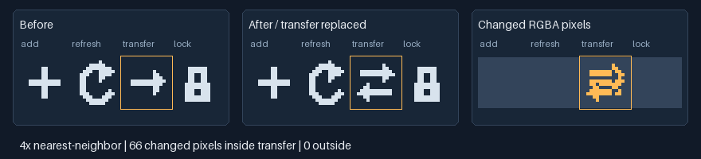

# Deterministic Pixel Art

[简体中文](README.zh-CN.md) · [MIT](LICENSE) · [Releases](https://github.com/Chenamel/deterministic-pixel-art/releases) · [AI install](INSTALL.md)

**Create editable pixel art with AI agents, then verify exactly what changed.**

Make PNG icons, sprites, UI components and named sprite atlases from text grids, integer drawing commands or Python masks. Import existing PNGs without quantization, edit a selected region and assemble separately drawn components. Built for AI-assisted game assets and pixel UI; Minecraft styling is optional.


[Icons and UI](demos/pixel-ui/README.md) · [128×128 sprite](examples/workflows/sprite-128.json) · [Four-chunk 256×256 scene](demos/chunk-scene/README.md). Existing original artwork, enlarged only by integer nearest-neighbor scaling.

**Version:** this checkout prepares **v1.2.0**; the latest published stable release is **v1.1.1**. [What changes in v1.2.0](docs/releases/v1.2.0.md). Examples below use this checkout; released packages have their own capabilities.

Stable v1.1.1 provides rendering, previews, validation and review. PNG import, named-cell replacement, exact change verification, assembly and recipes require this v1.2.0 checkout until the new stable package is published.

## Use with an AI agent

Give an agent with terminal and file access this request:

> Read https://github.com/Chenamel/deterministic-pixel-art/blob/codex/visual-quality/INSTALL.md and install deterministic-pixel-art. Use the latest stable release unless I request the v1.2.0 checkout. Check that it supports my intended task, then generate a sample PNG to verify installation.

[AI installation guide](INSTALL.md): select the environment, install the self-contained Skill and run a small render. It also includes an optional `npx skills` shortcut for supported agents. Agents without native Skill support can run the same tools from a task-local folder.

Once installed, try: “Use deterministic-pixel-art to create four 16×16 directional icons in a named atlas, keep a transparent one-pixel margin, and check each direction at native size.”

The guide link points to the review branch while its pull request is open; the default branch does not yet contain this guide.

## Use the Python CLI

Requires Python 3.10+ and Pillow >=10.4,<13. The requirements file pins Pillow 12.3.0 for reproducibility.

```sh
git clone --branch codex/visual-quality https://github.com/Chenamel/deterministic-pixel-art.git
cd deterministic-pixel-art
python -m venv .venv
```

Activate with `.\.venv\Scripts\Activate.ps1` in PowerShell, or `source .venv/bin/activate` on macOS/Linux, then:

```sh
python -m pip install -r requirements.txt
python src/pixel_art.py render --spec examples/gem-16.json --out output/gem.png --preview output/gem-preview.png
```

Expected output: a **16×16 PNG** and a **128×128 nearest-neighbor preview** in `output/`. Without Git, download and extract the checkout ZIP, then open a terminal in its top-level folder. Keep the editable spec with the PNG; existing outputs require explicit `--force` to overwrite.

## Choose a workflow

| Task | Start here |
|---|---|
| Small grid sprite | [Transparent grid](examples/transparent-grid.json), [mirrored gem](examples/gem-16.json) |
| Asymmetric sprite | [32×32 ship](examples/asymmetric-ship-32.json), [pixel-art guidance](skill/deterministic-pixel-art/references/pixel-art.md) |
| UI or button states | [Generic panel](examples/generic-panel-96x40.json), [UI guidance](skill/deterministic-pixel-art/references/ui.md), [recipes](skill/deterministic-pixel-art/references/recipes.md) |
| Existing PNG / named atlas edit | [Import, replace-cell and verify](docs/usage.md#edit-a-named-atlas-cell) |
| Image facts or review | [Text inspection](skill/deterministic-pixel-art/references/text-workflow.md), [review context](skill/deterministic-pixel-art/references/review.md) |
| Separate chunks | [Chunk contracts](skill/deterministic-pixel-art/references/chunking.md), [four-source scene](demos/chunk-scene/README.md) |
| Minecraft-style UI | [Optional guidance](skill/deterministic-pixel-art/references/minecraft.md) |

[More command examples](docs/usage.md) cover scoped edits, recipes and environment recovery. The [JSON v1 and Python API](skill/deterministic-pixel-art/references/formats.md) are available for custom generators. The [browser UI demo](demos/pixel-ui/README.md) includes actual-font and interaction checks.



This example changes **66 RGBA pixels inside one named cell, zero outside**. [Run the same edit and verification](docs/usage.md#edit-a-named-atlas-cell), or start with the [tiny grid recolor](docs/usage.md#change-one-grid-color).

## Evidence and limits

- **Reproducible assets:** 43 stable migration outputs remain pixel-compatible. Lossless import and scoped edits compare decoded RGBA, including hidden RGB under zero alpha.
- **Tested workflows:** source/package checks and Windows/Ubuntu CI cover rendering, inspection, import, editing and assembly. External agents have exercised eight task categories; original failures and incomplete records remain documented.
- **Art direction stays contextual:** inspect native-size assets on their intended backgrounds. Automated checks do not establish recognizability, general aesthetic gains, token savings or Minecraft game integration.

[Verification details and remaining limits](docs/verification.md) distinguish engineering checks, external use and visual judgment.

## Help and contribute

[Open an issue](https://github.com/Chenamel/deterministic-pixel-art/issues) for a bug, installation problem or a useful missing workflow. Include the command, error, Python/Pillow versions and a small input when possible. [Contribution guide](CONTRIBUTING.md).

## Development

```sh
python -m pip install -r requirements-dev.txt
python -B tools/check.py
```

Maintain runtime code in `src/`, recipes in `recipes/`, and guidance in `skill-content/`. `tools/package_skill.py` generates the standalone Skill under `skill/`. Full checks create local artifacts without globally installing a Skill. [Fixture provenance](docs/PROVENANCE.md).

## License

[MIT](LICENSE) covers the code, original artwork and standalone Skill. The repository-only UI demo includes unmodified Silkscreen Regular under [SIL OFL 1.1](demos/pixel-ui/fonts/OFL.txt); the font is not in the Skill ZIP. Pillow and development-only PyYAML are installed dependencies, not vendored files.
