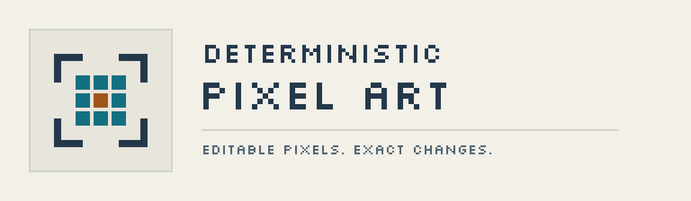
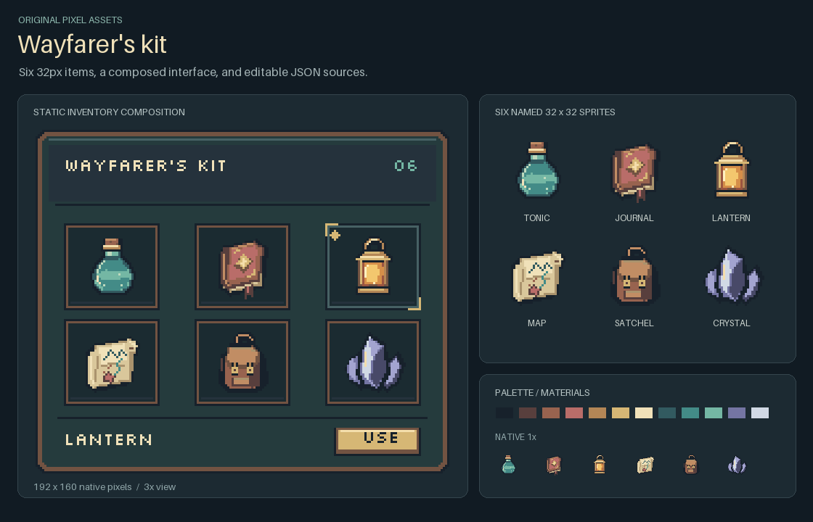
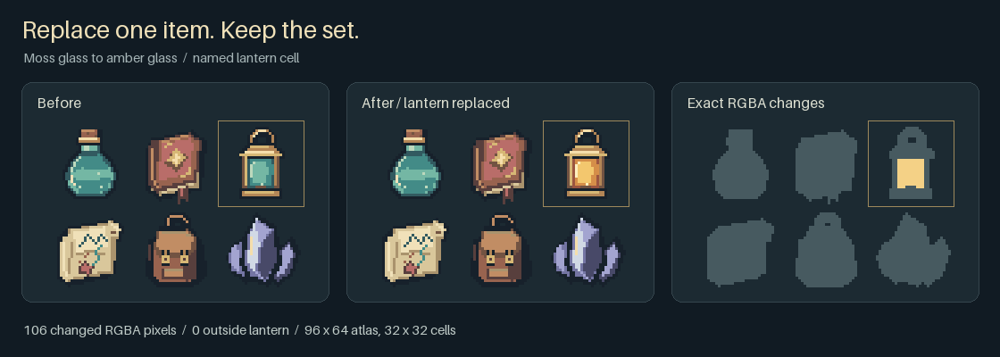

# Deterministic Pixel Art

[简体中文](README.zh-CN.md) · [MIT](LICENSE) · [Releases](https://github.com/Chenamel/deterministic-pixel-art/releases) · [AI Install Guide](INSTALL.md) · [Changelog](CHANGELOG.md)

[](https://github.com/Chenamel/deterministic-pixel-art/releases/latest)
[](https://github.com/Chenamel/deterministic-pixel-art/actions/workflows/test.yml)
[](INSTALL.md)
[](LICENSE)

<picture>
  <source media="(prefers-color-scheme: dark)" srcset="docs/images/brand/header-en-dark.png">
  <source media="(prefers-color-scheme: light)" srcset="docs/images/brand/header-en-light.png">
  
</picture>

**Let AI agents draw crisp, hard-edged pixel art—and edit only the part you asked to change.**

Create game icons, sprites, inventory UI, and multi-item sprite sheets that always come back with editable sources, native-size PNGs, and enlarged previews. When updating an existing PNG, only your chosen region or color changes—the surrounding pixels and transparent background stay untouched.



[Travel kit demo](demos/travel-kit/README.md) · [Native UI PNG](demos/travel-kit/assets/ui.png) · [Item atlas source](demos/travel-kit/assets/after.json). Six 32×32 items combined into a 192×160 inventory UI with matching editable specs and previews.

**Latest stable release: v1.4.0** — [Download Skill ZIP or DSH plugin](https://github.com/Chenamel/deterministic-pixel-art/releases/latest) · [Discussion & showcase](https://github.com/Chenamel/deterministic-pixel-art/discussions/30). Adds one-step asset delivery bundles, ready-to-copy commands for AI agents, and built-in checks that spot stray pixels or broken tiny parts.

## Use with an AI agent

Paste this message to any AI assistant that has terminal and file access:

> Read <https://github.com/Chenamel/deterministic-pixel-art/blob/main/INSTALL.md> and install deterministic-pixel-art from the latest stable release. Check that it supports my task, then generate a small sample PNG to confirm the setup works.

Once installed, you can drive everything in plain language—for example:
- *"Make a 32×32 brass compass icon on a transparent background with crisp lighting on `#172033`, and keep the editable source."*
- *"Create six matching 32×32 travel items and arrange them into a small inventory panel."*
- *"Recolor only the lantern glass in this PNG to amber while keeping the outline and everything else unchanged."*

See the [AI Installation Guide](INSTALL.md) for virtual-environment setup and optional `npx skills` commands. If you use **DSH**, follow the [DSH quick-start](integrations/dsh/README.md) to install `0.1.5` via npm or the release archive and chat right away.

## Use from the command line

Requires Python 3.10+ and Pillow `>=10.4,<13` (pinned to Pillow 12.3.0 in `requirements.txt` for reproducible builds).

```sh
git clone https://github.com/Chenamel/deterministic-pixel-art.git
cd deterministic-pixel-art
python -m venv .venv
```

Activate with `.\.venv\Scripts\Activate.ps1` (PowerShell) or `source .venv/bin/activate` (macOS/Linux), then run:

```sh
python -m pip install -r requirements.txt
python src/pixel_art.py render --spec examples/gem-16.json --out output/gem.png --preview output/gem-preview.png
```

This creates a native **16×16 PNG** and a **128×128 nearest-neighbor preview** inside `output/`. Keep the editable source alongside the PNG; overwriting existing files requires `--force`.

## Common workflows

| Goal | Start here |
|---|---|
| One-step delivery & packaging bundle | `recipes/asset_toolkit.py`, [toolkit guide](skill/deterministic-pixel-art/references/toolkit.md) |
| Item sets & inventory UI | [Travel kit demo & UI panel](demos/travel-kit/README.md) |
| Small symmetric icons | [Transparent grid](examples/transparent-grid.json), [mirrored gem](examples/gem-16.json) |
| Asymmetric sprites | [32×32 ship](examples/asymmetric-ship-32.json), [pixel-art guide](skill/deterministic-pixel-art/references/pixel-art.md) |
| Buttons & multi-state UI | [Generic panel](examples/generic-panel-96x40.json), [UI guide](skill/deterministic-pixel-art/references/ui.md), [Python recipes](skill/deterministic-pixel-art/references/recipes.md) |
| Edit an existing PNG or atlas cell | [Import, replace-cell & verify](docs/usage.md#edit-a-named-atlas-cell) |
| Check for stray specks or broken parts | [Image inspection](skill/deterministic-pixel-art/references/text-workflow.md), [review guide](skill/deterministic-pixel-art/references/review.md) |
| Multi-chunk large scenes | [Chunk contracts](skill/deterministic-pixel-art/references/chunking.md), [four-part bridge demo](demos/chunk-scene/README.md) |
| Minecraft-style UI slots | [Optional Minecraft guide](skill/deterministic-pixel-art/references/minecraft.md) |

See [more command examples](docs/usage.md) for scoped color replacements, [the format reference](skill/deterministic-pixel-art/references/formats.md) if you write your own generators, and [the browser UI demo](demos/pixel-ui/README.md) for checking real font fit and hover states.



Here only **106 pixels inside the lantern cell changed—zero outside**. The lantern's frame, atlas coordinates, and the other five items stay identical. Try [the named-item replacement walkthrough](demos/travel-kit/README.md#replace-one-named-item) or [recolor one grid shade](docs/usage.md#change-one-grid-color).

## What to keep in mind

- **Made for hard-edged pixel art:** Exact PNG edits require static, single-frame PNGs at up to 8-bit channel depth. Keep your editable spec or original PNG when planning later revisions.
- **Checks assist your eyes—always check 1×:** Built-in checks catch unintended pixel drift, disconnected bits, and isolated specks, but readability and style still need a quick look at native size on the real target background.
- **Full engineering & test boundaries:** Reproducible test baselines, supported runtime ranges, and external agent trial notes are documented in [Verification details & limits](docs/verification.md).

## Help and contribute

Found a bug, setup snag, or workflow gap? [Open an issue](https://github.com/Chenamel/deterministic-pixel-art/issues) with the command, error message, Python/Pillow versions, and a tiny sample input if possible, or join [Discussion #30](https://github.com/Chenamel/deterministic-pixel-art/discussions/30). See [Contributing](CONTRIBUTING.md) before sending code changes.

## Development checks

```sh
python -m pip install -r requirements-dev.txt
python -B tools/check.py
```

Source code lives in `src/`, example scripts in `recipes/`, and Skill docs in `skill-content/`. Running `tools/package_skill.py` regenerates the self-contained Skill under `skill/`. See [the source-to-Skill map](CONTRIBUTING.md#source-and-generated-skill), [formatting scope](CONTRIBUTING.md#python-formatting), and [fixture provenance](docs/PROVENANCE.md).

## License

Code, original artwork, and the standalone Skill are licensed under [MIT](LICENSE). Repository previews use Silkscreen Regular ([SIL OFL 1.1](demos/pixel-ui/fonts/OFL.txt)) and Fusion Pixel Font ([SIL OFL 1.1](assets/brand/font-notices/README.md)), which are not bundled in the Skill ZIP. Pillow and development-only PyYAML/Ruff are installed separately via pip.
