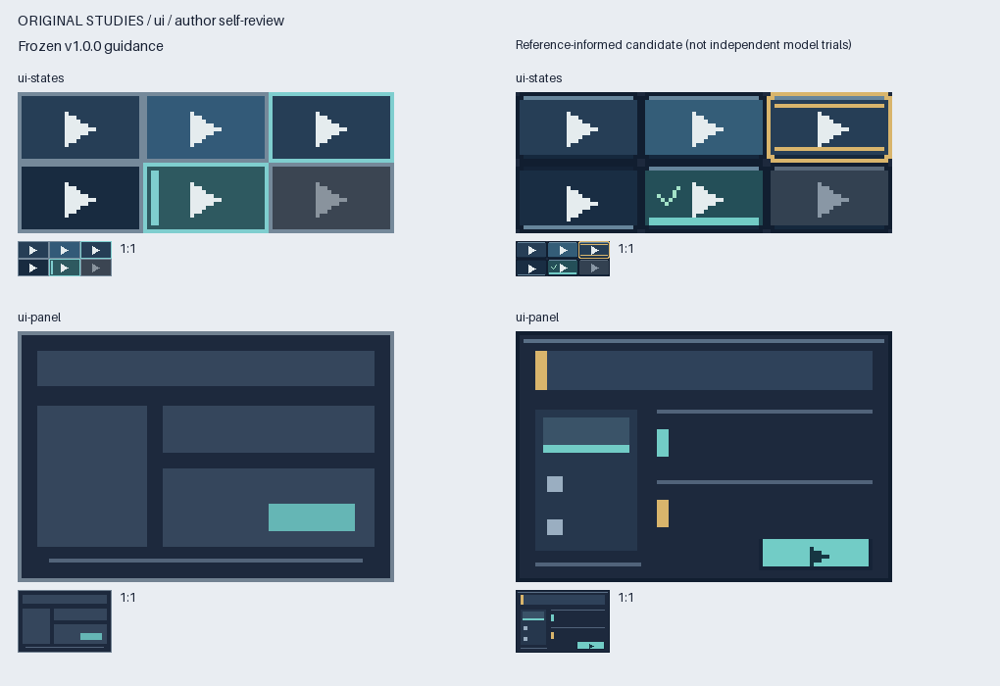
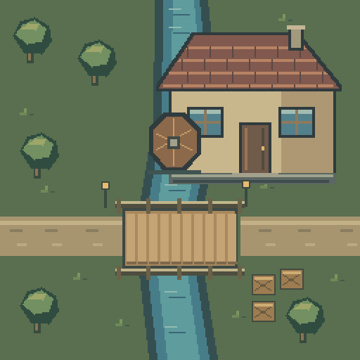

# 确定性像素资产

[English](README.md) · [MIT 协议](LICENSE) · [规格与 Python API](skill/deterministic-pixel-art/references/formats.md)

通过字符网格、整数绘图指令、像素蒙版和命名图集生成可编辑的 PNG。运行时只依赖 Python 与 Pillow，使用精确像素坐标与最近邻预览。Minecraft GUI 风格是可选预设。



## 快速上手

初始验证环境为 Python 3.14.2、Pillow 12.3.0。在仓库目录创建虚拟环境：

```sh
python -m venv .venv
```

Windows PowerShell 激活：`.\.venv\Scripts\Activate.ps1`；macOS/Linux shell：`source .venv/bin/activate`。

```sh
python -m pip install -r requirements.txt
python src/pixel_art.py render --spec examples/gem-16.json --out output/gem.png --preview output/gem-preview.png
python src/pixel_art.py validate --image output/gem.png
python src/pixel_art.py inspect --image output/gem.png --grid
python src/pixel_art.py review --image output/gem.png --out-dir output/gem-review
```

在其他工作目录执行时，为脚本、输入和输出使用绝对路径。已有输出默认拒绝覆盖，需要有意覆盖时使用 `--force`。

## 选择示例

| 示例 | 用途 |
|---|---|
| [gem-16.json](examples/gem-16.json) | 自定义调色板、镜像的 16×16 精灵 |
| [asymmetric-ship-32.json](examples/asymmetric-ship-32.json) | 多边形构成的 32×32 非对称精灵 |
| [generic-panel-96x40.json](examples/generic-panel-96x40.json) | 非 Minecraft 配色的通用 GUI |
| [minecraft-button-states.json](examples/minecraft-button-states.json) | 五种命名按钮状态组成的图集 |
| [quality/](examples/quality/) | 八项可编辑范例：图标、材质、UI 状态、布局及 Minecraft 控件 |
| [transparent-grid.json](examples/transparent-grid.json) | 可直接使用的最小透明网格 |
| [workflows/](examples/workflows/) | 图集单格编辑、原生 128×128 飞船、256×256 组件与分块场景 |

规格与 PNG 一起保存。检查原尺寸与放大预览；尺寸和像素断言不能代替对方向、状态语义和辨识度的判断。

**已发布的 v1.2.0-rc.2 预发布版**提供“保留名称导入图集 → 修改一格 → 验证其他像素”和组件/分块拼合流程：

```sh
python src/pixel_art.py import --image examples/workflows/atlas-before.png --metadata examples/workflows/atlas-before-layout.json --out output/editable.json
python src/pixel_art.py replace-cell --spec output/editable.json --cell transfer --replacement examples/workflows/atlas-replacement.json --out output/candidate.json --image-out output/candidate.png --metadata output/candidate-layout.json
python src/pixel_art.py verify --image output/candidate.png --compare examples/workflows/atlas-before.png --allow-region 32 0 16 16
python src/pixel_art.py assemble --project examples/workflows/scene-tiles.json --out output/scene.png --report output/assembly.json --seams output/seams.png
```




详细用法见[编辑与拼合指南](skill/deterministic-pixel-art/references/workflows.md)。`render --preview-background E9EDF2` 可直接选预览底色。文件系统拒绝硬链接时，可选本地输出目录或显式使用 `--portable-output`；后者保留拒绝覆盖，但新文件在写入期间可能被其他读取者看到。

`review` 输出审阅图与建议性 JSON 报告，包括原尺寸、整数放大、深浅背景、灰度，以及可选的命名单元、精灵剪影与基线差异。通过[审阅上下文](skill/deterministic-pixel-art/references/review.md)声明目标背景、内容预留区和功能性颜色对。有提示仍返回成功，无效输入返回错误；工具不修改原图，也不为审美打分。

[格式说明](skill/deterministic-pixel-art/references/formats.md)包含 JSON v1、简短 GUI DSL、`render(spec)`、`Canvas`、校验规则与图集元数据。未知符号、未知指令、隐式裁切会明确报错。矩形坐标统一为 `x, y, width, height`。

## 可读创作配方（本地rc.5）

反复调整颜色、尺寸或部件时，可修改短配方参数，再生成完整JSON与PNG：

```sh
python recipes/icons.py --out-dir output/icons --ink F5C26B
python recipes/buttons.py --out-dir output/buttons --width 64 --content 28 4 30 10 --hover 426B83
python recipes/courier128.py --out-dir output/courier --stripe E17B57 --stripe-light F9D5A0
```

分发Skill中的位置是 `<skill>/scripts/recipes/`。128飞船常用编辑入口为49行配方（另有共享辅助），原展开JSON为33,744行；输出规格仍完整。此前rc.3配方使包体增加4.3%，本次rc.4相对rc.3再增加3.359%。[配方实测及限制](docs/recipe-workflows.zh-CN.md)；未据此宣称节省token或普遍提高审美。真实字体和消费端交互见下方示例。

本地rc.4另附一个分别绘制的双块小桥，直接演练局部改色：

```sh
python recipes/chunk_pair.py --out-dir output/bridge
python recipes/chunk_pair.py --out-dir output/bridge-blue --flag 73A5AA
python src/pixel_art.py verify --image output/bridge-blue/asset.png --compare output/bridge/asset.png --allow-region 51 5 6 4
```

[分块指导](skill/deterministic-pixel-art/references/chunking.md)说明像素所有权、全局纹理相位和单块重建；接入文字/交互时再读[消费端指导](skill/deterministic-pixel-art/references/consumer-ui.md)。完整[原生256示例](demos/chunk-scene/README.md)单独保留。原生512暂缓，待具体消费端/细节需求明确后再启动。[候选收口结果与限制](docs/candidate-closeout.zh-CN.md)。

本地rc.5补充直接导出命名单格的入口：

```sh
python src/pixel_art.py import --image examples/workflows/atlas-before.png --metadata examples/workflows/atlas-before-layout.json --cell transfer --out output/transfer.json
```

检查完整源图布局/摘要后，得到可独立编辑的精确grid/draw，再交给 `replace-cell`；完整图集导入默认行为不变。[三平台复测核验](docs/p1-results.zh-CN.md)区分已验证修复、使用痛点和未证明项。冻结P1包仍用rc.2，rc.5未发布为稳定版或替换本地安装。

三份外部定向任务已收回并核验：[结果与改进](docs/p1-results.zh-CN.md)。[原任务分工和冻结下载](docs/focused-trials.zh-CN.md)保留作复现入口，无需重复执行。本地稳定安装仍v1.1.1。

## 真实 PNG 使用端示例

```sh
python tools/build_consumer_demo.py --force
python -m http.server 8765 --bind 127.0.0.1 --directory demos/pixel-ui
```

浏览器打开 `http://127.0.0.1:8765/`。这个[仅仓库包含的示例](demos/pixel-ui/README.md)加载命名PNG图集、实际拉丁像素字体，支持原生鼠标/键盘、六态和1/2/3倍缩放。可切换64px基线与96px修正，查看真实 `EXPORT MAP` 标签从溢出到适配的对照。[结果与限制](docs/consumer-ui-report.zh-CN.md)：89项源码测试、43张稳定图与77项独立ZIP场景通过，封存Skill ZIP不变；未宣称中文/Minecraft字体或游戏内验收。

另外新增[独立256分块示例](demos/chunk-scene/README.md)：四个128局部源码分别绘制，先冻结风格/边界合同，再用现有拼合器组合；含接缝审阅和单块旗帜修改的精确保留证明。[P4a报告](docs/chunk-scene-report.zh-CN.md)记录94项源码测试和实际命令结果。它仅在仓库，不是把整图裁切重组，也不代表已验证原生512或多模型盲作。

## 作为 Codex Skill 使用

从 [Releases](https://github.com/Chenamel/deterministic-pixel-art/releases) 下载 Skill ZIP 与 SHA-256 清单；版本 tag 同时固定运行时和指导文档，`v1.0.0` 保留上一稳定基线。验证哈希后，将压缩包中的 `deterministic-pixel-art` 整个目录放到 Codex 的 skills 目录（`$CODEX_HOME/skills`，默认 `~/.codex/skills`），并在任务可用的 Python 环境中安装该目录的 `requirements.txt`。旧版备份应放在 skills 发现目录之外。仓库中的同一分发目录是 [skill/deterministic-pixel-art](skill/deterministic-pixel-art/SKILL.md)。

调用示例：“使用 `$deterministic-pixel-art` 创建四个 16×16 方向图标，放入有状态名称的横向图集，保留一像素透明边距，并生成放大预览。”

安装开发依赖后运行 `python -B tools/check.py`，可生成经过测试的 ZIP。压缩包在本地生成，不提交到仓库；检查过程不安装全局 Skill。

## 实测收益与代价

已有 PNG 可先用 `import --image existing.png --out editable.json` 转为规格，附加 `--metadata layout.json` 可保留命名单元。保持解码后的 8 位 RGBA，包括透明像素下的 RGB，不自动减色。详见[纯文本工作流](skill/deterministic-pixel-art/references/text-workflow.md)。

八项外部探索任务提供了实质反馈，10 张主要最终 PNG 已在固定基准环境精确复现，但这些不是原先约定的受控 A/B 试验。修复、逐像素编辑和拼合结果见[本轮报告](docs/workflow-report.zh-CN.md)；[早期候选版方案](docs/audit-v1.2.md)保留为历史记录。暂不宣称减少修改轮次、节省 token 或普遍提高画质；最新稳定版及本地已安装 Skill 保持 v1.1.1。

准备交给不同 AI 测评时，使用[分发指南和完整提示词](docs/agent-testing-guide.zh-CN.md)。`tools/prepare_agent_trials.py` 可将已发布 Agent 包拆成“一个版本、一个任务、一个新会话”的 ZIP；固定对照、开放审计、创作研究与独立验收分别记录，便于核对具体改进点。

此前 rc.1 同机 Windows 对比 v1.1.0，完整 render/review 命令中位耗时分别增加 15.0/16.7 ms（约 9%），样例审阅 JSON 从 1,237 增至 6,999 字节，纯渲染基本持平。这些历史运行与上下文成本单独披露，不作为 Agent 工作流收益。

v1.1.1 修复空描边、主审阅背景、宽图拼板及文件提交问题，并补充错误定位和 Pillow 兼容检查。详见[外部反馈与可靠性报告](docs/audit-feedback.md)；这些修复不附带新的审美提升结论。

本次质量更新增加按任务选择的创作指导、八项原创可编辑范例及上下文审阅工具。八项前后对照的**作者代理自评**中，六项改善、两项保持原像素；**v1.0.0 的 43 张迁移产物全部保持像素兼容**。JSON v1、现有 Python 公共接口与旧命令行为保留。样本有限且未盲评，不能据此证明模型的通用画质提高；未做真实字体适配和游戏内验收。详见[质量报告](docs/quality-report.zh-CN.md)、[英文报告](docs/quality-report.md)和[原始结果](docs/measurements/visual-quality.json)。

以下是此前渲染优化的独立历史比较：

初始 Windows 评估中，43 张历史图有 40 张逐像素保持。3 张有意变化修复了不完整的按钮合成，或将 footer 对齐实际使用中的资源。

| 纯渲染场景 | 原版 → 新版中位耗时 | 倍率 |
|---|---:|---:|
| 128×48 面板 | 1.3364 → 0.1519 ms | 8.80× |
| 16×16 方块面 | 0.3214 → 0.1032 ms | 3.11× |
| 80×16 图集 | 0.5105 → 0.4381 ms | 1.17× |

以上是单一环境实测，不含进程启动和磁盘 I/O。相同产物的完整命令**慢了 47.03 ms（+35%）**；图集尾部耗时及部分 Python 分配峰值也增加。未测量 token 节省、模型修正轮次或游戏内质量。详见[完整报告](docs/optimization-report.zh-CN.md)和[实测 JSON](docs/measurements/metrics.json)。

这些资产的纯渲染已低于一毫秒，继续压榨速度的绝对收益有限。本次质量更新不宣称节省创作耗时或 token；更丰富的细节也可能增加颜色与绘图操作。

## 开发检查

```sh
python -m pip install -r requirements-dev.txt
python -B tools/check.py
```

检查包含源码单元测试、43 张逐图回归、86 个历史夹具文件和八项冻结研究基线的完整性校验、八项无损导入/分析场景、可执行编辑与拼合对照、基准测试、可复现 ZIP 打包及独立目录包执行检查。[本轮报告](docs/workflow-report.zh-CN.md)记录当前实际数量。工作目录含中文和空格，不依赖原模组路径或 Codex 安装；产物写入被 Git 忽略的 `output/` 与 `evaluation/`。

如有 skill-creator 官方校验器，可追加执行：

```sh
python -B tools/test_skill.py --python /path/to/python --validator /path/to/quick_validate.py
```

默认内置的项目校验器检查元数据与引用，不冒充官方校验器。GitHub Actions 配置了 Windows、Ubuntu 和 Python 3.14；配置存在不等于已在相应平台通过。

`src/` 是运行时源码，`skill-content/` 是维护的指导与参考文档，`skill/` 是生成的分发版本。修改源目录后运行检查来同步 Skill；`tools/package_skill.py` 复制来源并记录逐文件清单。`quality/` 保留需求、冻结基线、备选和自评记录。`baselines/` 只保留必要历史夹具，见[来源说明](docs/PROVENANCE.md)；原项目完整保护档案保留在仓库之外。

## 协议

项目代码、原创图像与独立 Skill 使用 [MIT](LICENSE)。仅仓库演示附带的未修改Silkscreen Regular另遵循 [SIL OFL1.1](demos/pixel-ui/fonts/OFL.txt)，不进入Skill ZIP。Pillow 和仅开发使用的 PyYAML 通过依赖安装，不随仓库捆绑。
