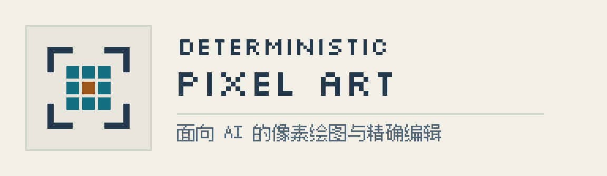

# Deterministic Pixel Art

[English](README.md) · [MIT](LICENSE) · [版本下载](https://github.com/Chenamel/deterministic-pixel-art/releases) · [交给AI安装](INSTALL.md)

<picture>
  <source media="(prefers-color-scheme: dark)" srcset="docs/images/brand/header-zh-CN-dark.png">
  <source media="(prefers-color-scheme: light)" srcset="docs/images/brand/header-zh-CN-light.png">
  
</picture>

**让 AI 创作可编辑的像素素材，并精确核对每次修改。**

用字符网格、整数绘图指令或 Python 蒙版制作 PNG 图标、精灵和 UI，也可以给多张小图命名后组成图集。支持无损导入已有 PNG、修改指定区域，以及拼接独立绘制的组件。适合用 AI 辅助制作游戏素材和像素 UI，Minecraft 风格可按需选用。


[图标与 UI](demos/pixel-ui/README.md) · [128×128 精灵](examples/workflows/sprite-128.json) · [四块拼接的 256×256 场景](demos/chunk-scene/README.md)。展示使用项目已有的原创素材，放大时仅使用整数倍最近邻缩放，保持像素边缘清晰。

**版本：v1.2.0。** [下载稳定版 Skill](https://github.com/Chenamel/deterministic-pixel-art/releases/tag/v1.2.0) · [版本变化](docs/releases/v1.2.0.zh-CN.md)。PNG 导入、按名称替换图集中的一格、逐像素核对修改、组件拼接和示例脚本需要 v1.2.0；v1.1.1 仅提供渲染、预览、校验和图片检查。

## 交给 AI 使用

向具备终端和文件操作能力的 AI 发送：

> 请读取 <https://github.com/Chenamel/deterministic-pixel-art/blob/main/INSTALL.md>，从最新稳定版安装 deterministic-pixel-art。先确认它支持我要做的任务，再生成示例 PNG 验证安装。

[AI 安装指南](INSTALL.md)说明如何选择 Python 环境、安装 Skill，并生成一张示例图确认安装成功；部分 AI 工具也可选用 `npx skills` 安装。不支持自动加载 Skill 的 AI，也能在任务目录直接运行同一套脚本。

安装后可以说：“使用 deterministic-pixel-art 制作四个16×16方向图标，组成命名图集，保留1px透明边距，并在原尺寸核对各方向。”

## 直接使用 Python 工具

需要 Python 3.10+、Pillow >=10.4,<13。依赖文件锁定 Pillow 12.3.0，便于复现。

```sh
git clone https://github.com/Chenamel/deterministic-pixel-art.git
cd deterministic-pixel-art
python -m venv .venv
```

PowerShell 激活：`.\.venv\Scripts\Activate.ps1`；macOS/Linux 激活：`source .venv/bin/activate`，然后执行：

```sh
python -m pip install -r requirements.txt
python src/pixel_art.py render --spec examples/gem-16.json --out output/gem.png --preview output/gem-preview.png
```

预期在 `output/` 得到 **16×16 PNG** 和 **128×128 最近邻预览图**。没有 Git 时，可下载并解压仓库 ZIP，在顶层文件夹打开终端。规格与 PNG 一起保留；覆盖已有输出需要明确使用 `--force`。

## 按任务选入口

| 任务 | 从这里开始 |
|---|---|
| 小型网格精灵 | [透明网格](examples/transparent-grid.json)、[镜像宝石](examples/gem-16.json) |
| 新建非对称精灵 | [32×32飞船](examples/asymmetric-ship-32.json)、[像素画指导](skill/deterministic-pixel-art/references/pixel-art.md) |
| UI 与按钮状态 | [通用面板](examples/generic-panel-96x40.json)、[UI 指导](skill/deterministic-pixel-art/references/ui.md)、[Python 示例脚本](skill/deterministic-pixel-art/references/recipes.md) |
| 已有 PNG / 图集的局部修改 | [导入、单格替换与差异核对](docs/usage.zh-CN.md#修改命名图集的单格) |
| 分析图片、检查效果 | [文本分析](skill/deterministic-pixel-art/references/text-workflow.md)、[背景、布局和检查选项](skill/deterministic-pixel-art/references/review.md) |
| 独立分块绘制 | [分块与接缝约定](skill/deterministic-pixel-art/references/chunking.md)、[四块拼接场景](demos/chunk-scene/README.md) |
| Minecraft 风格 UI | [专项指导](skill/deterministic-pixel-art/references/minecraft.md) |

[更多命令示例](docs/usage.zh-CN.md)介绍局部修改、Python 示例脚本和环境问题处理。编写自己的绘图脚本时，可参考 [JSON v1 与 Python API](skill/deterministic-pixel-art/references/formats.md)。[浏览器 UI 演示](demos/pixel-ui/README.md)还展示如何检查真实字体和按钮交互。


此例只改变 transfer 这一格内的 **66 个 RGBA 像素，这一格以外没有变化**。可以[运行同一个局部修改示例](docs/usage.zh-CN.md#修改命名图集的单格)，或从[小网格改色](docs/usage.zh-CN.md#修改网格的一种颜色)开始。

## 测试结果与使用限制

- **像素一致性：** 43 张基准图片保持像素一致。无损导入和局部修改会比较解码后的 RGBA 值，包括全透明像素里的 RGB。
- **已测功能：** 源码测试、安装包测试和 Windows/Ubuntu CI 覆盖渲染、分析、导入、编辑和拼接。外部 AI 试用覆盖八类任务；记录中保留了原始失败和缺失的操作过程。
- **实际效果仍需看图：** 请按原尺寸、在实际使用的背景上检查图片。自动检查不能判断图标是否容易辨认，也不能证明工具能普遍改善视觉效果、节省 token，或保证 Minecraft 游戏内显示正确。

[验证详情](docs/verification.zh-CN.md)分别说明功能测试、外部试用和图片效果检查的结果及限制。

## 帮助与贡献

遇到缺陷、安装问题或有用的工作流缺口，可以[提交 Issue](https://github.com/Chenamel/deterministic-pixel-art/issues)。尽量附命令、错误、Python/Pillow 版本和最小输入。[贡献指南](CONTRIBUTING.md)。

## 开发检查

```sh
python -m pip install -r requirements-dev.txt
python -B tools/check.py
```

工具代码位于 `src/`，Python 示例脚本位于 `recipes/`，Skill 说明的源文件位于 `skill-content/`；`tools/package_skill.py` 在 `skill/` 生成独立 Skill。完整检查会生成本地文件，不会自动安装到用户的 Skill 目录。[测试样本来源](docs/PROVENANCE.md)。

## 协议

代码、原创图像和独立 Skill 使用 [MIT](LICENSE)。仓库展示使用的 Silkscreen Regular 遵循 [SIL OFL 1.1](demos/pixel-ui/fonts/OFL.txt)，Fusion Pixel Font 遵循 [SIL OFL 1.1](assets/brand/font-notices/README.md)。字体不进入 Skill ZIP。Pillow 与仅开发使用的 PyYAML 通过依赖安装，不随包捆绑。
