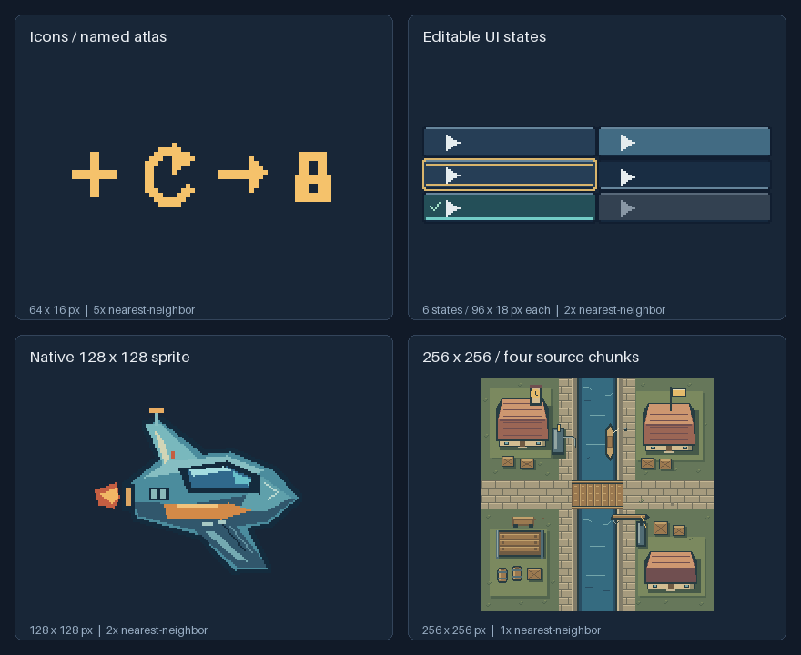

# 确定性像素资产

[English](README.md) · [MIT](LICENSE) · [版本下载](https://github.com/Chenamel/deterministic-pixel-art/releases) · [交给AI安装](INSTALL.md)

**让 AI 创作可编辑的像素素材，并精确核对每次修改。**

用字符网格、整数绘图指令或 Python 蒙版制作 PNG 图标、精灵、UI 和命名图集。可以无损导入已有 PNG、修改指定区域，并组合独立绘制的组件。面向 AI 辅助游戏素材与像素 UI 创作，Minecraft 风格按需选用。



[图标与 UI](demos/pixel-ui/README.md) · [128×128 精灵](examples/workflows/sprite-128.json) · [四块拼接的256×256场景](demos/chunk-scene/README.md)。展示使用已有原创素材，仅做整数倍最近邻放大。

**版本：当前工作树正在准备 v1.2.0，最新已发布稳定版为 v1.1.1。** [v1.2.0 的变化](docs/releases/v1.2.0.zh-CN.md)。下方示例适用于本工作树，发布包以各自版本能力为准。

## 交给 AI 使用

向具备终端和文件操作能力的 AI 发送：

> 请从 https://github.com/Chenamel/deterministic-pixel-art 安装 deterministic-pixel-art，按仓库 INSTALL.md 操作，选择最新稳定版，并实际生成一张示例 PNG 后再报告安装成功。

[AI 安装指南](INSTALL.md)包含环境选择、独立 Skill 安装和最小渲染验证，也提供支持的 Agent 可选用的 `npx skills` 捷径。没有原生 Skill 支持的 Agent，也能在任务目录直接运行同一套工具。

安装后可以说：“使用 deterministic-pixel-art 制作四个16×16方向图标，组成命名图集，保留1px透明边距，并在原尺寸核对各方向。”

## 直接使用 Python 工具

需要 Python 3.10+、Pillow >=10.4,<13。依赖文件锁定 Pillow 12.3.0，便于复现。

```sh
git clone https://github.com/Chenamel/deterministic-pixel-art.git
cd deterministic-pixel-art
python -m venv .venv
```

PowerShell 激活：`.\.venv\Scripts\Activate.ps1`；macOS/Linux 激活：`source .venv/bin/activate`，然后执行：

```sh
python -m pip install -r requirements.txt
python src/pixel_art.py render --spec examples/gem-16.json --out output/gem.png --preview output/gem-preview.png
```

预期在 `output/` 得到 **16×16 PNG** 和 **128×128 最近邻预览图**。没有 Git 时，可下载并解压仓库 ZIP，在顶层文件夹打开终端。规格与 PNG 一起保留；覆盖已有输出需要明确使用 `--force`。

## 按任务选入口

| 任务 | 从这里开始 |
|---|---|
| 小型网格精灵 | [透明网格](examples/transparent-grid.json)、[镜像宝石](examples/gem-16.json) |
| 新建非对称精灵 | [32×32飞船](examples/asymmetric-ship-32.json)、[像素画指导](skill/deterministic-pixel-art/references/pixel-art.md) |
| UI 与按钮状态 | [通用面板](examples/generic-panel-96x40.json)、[UI指导](skill/deterministic-pixel-art/references/ui.md)、[短配方](skill/deterministic-pixel-art/references/recipes.md) |
| 已有 PNG / 命名图集局改 | [导入、单格替换与差异核对](docs/usage.zh-CN.md#修改命名图集的单格) |
| 图片事实与审阅 | [文本分析](skill/deterministic-pixel-art/references/text-workflow.md)、[审阅上下文](skill/deterministic-pixel-art/references/review.md) |
| 独立分块绘制 | [边界约定](skill/deterministic-pixel-art/references/chunking.md)、[四入口场景](demos/chunk-scene/README.md) |
| Minecraft 风格 UI | [专项指导](skill/deterministic-pixel-art/references/minecraft.md) |

[更多命令示例](docs/usage.zh-CN.md)包含局改、配方和环境恢复。自定义生成器可参考 [JSON v1 与 Python API](skill/deterministic-pixel-art/references/formats.md)。[浏览器 UI 演示](demos/pixel-ui/README.md)另含真实字体和交互检查。

## 实测依据与边界

- **可复现素材：** 43张稳定迁移产物保持像素兼容。无损导入和局改比较解码 RGBA，包括全透明像素里的 RGB。
- **已测工作流：** 源码、整包检查和 Windows/Ubuntu CI 覆盖渲染、分析、导入、编辑与组合。外部 Agent 已使用八类任务，原始失败和过程记录缺口继续保留。
- **视觉判断结合用途：** 在目标背景检查原尺寸。自动检查不能证明语义辨识度、普遍审美收益、token 节省或 Minecraft 游戏内适配。

[验证详情与保留限制](docs/verification.zh-CN.md)区分工程检查、外部使用和视觉判断。

## 帮助与贡献

遇到缺陷、安装问题或有用的工作流缺口，可以[提交 Issue](https://github.com/Chenamel/deterministic-pixel-art/issues)。尽量附命令、错误、Python/Pillow 版本和最小输入。[贡献指南](CONTRIBUTING.md)。

## 开发检查

```sh
python -m pip install -r requirements-dev.txt
python -B tools/check.py
```

运行时维护在 `src/`，配方在 `recipes/`，指导源在 `skill-content/`；`tools/package_skill.py` 在 `skill/` 生成独立 Skill。完整检查生成本地产物，不自动安装全局 Skill。[夹具来源](docs/PROVENANCE.md)。

## 协议

代码、原创图像和独立 Skill 使用 [MIT](LICENSE)。仅仓库 UI 演示附带的未修改 Silkscreen Regular 遵循 [SIL OFL 1.1](demos/pixel-ui/fonts/OFL.txt)，字体不进入 Skill ZIP。Pillow 与仅开发使用的 PyYAML 通过依赖安装，不随包捆绑。
