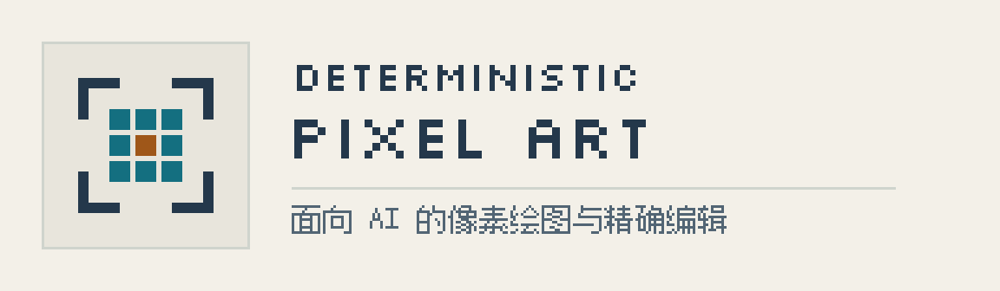
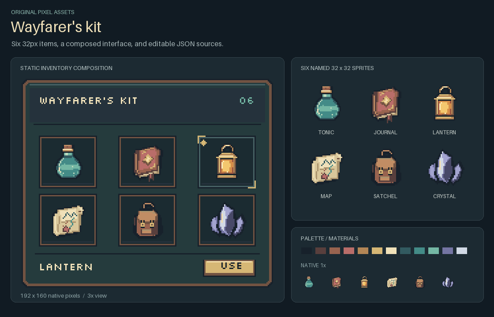
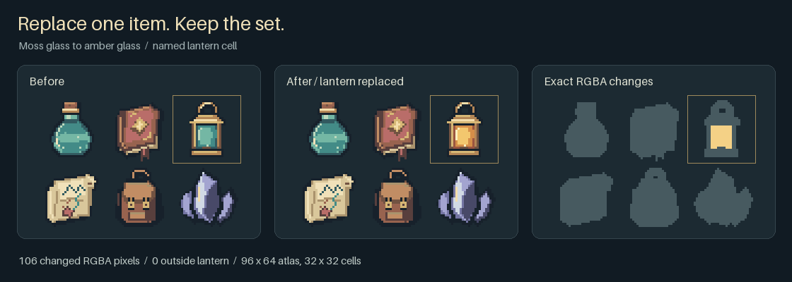

# Deterministic Pixel Art

[English](README.md) · [MIT](LICENSE) · [版本下载](https://github.com/Chenamel/deterministic-pixel-art/releases) · [AI 安装指南](INSTALL.md) · [更新日志](CHANGELOG.md)

[](https://github.com/Chenamel/deterministic-pixel-art/releases/latest)
[](https://github.com/Chenamel/deterministic-pixel-art/actions/workflows/test.yml)
[](INSTALL.md)
[](LICENSE)

<picture>
  <source media="(prefers-color-scheme: dark)" srcset="docs/images/brand/header-zh-CN-dark.png">
  <source media="(prefers-color-scheme: light)" srcset="docs/images/brand/header-zh-CN-light.png">
  
</picture>

**让 AI 稳定画出硬边像素图、图标与 UI，并且只改你让改的那一块。**

无论是从零画游戏道具、人物精灵、物品栏界面，还是修改一张现有 PNG 里的某个部位，这套工具都能同时交付可二次编辑的源文件、原尺寸图和放大预览；局部改色或微调时，未选中区域的像素和透明背景保持一像素不动。



[可编辑旅行用品示范](demos/travel-kit/README.md) · [原尺寸 UI PNG](demos/travel-kit/assets/ui.png) · [命名物品图集](demos/travel-kit/assets/after.json)。六件 32×32 原创道具与 192×160 静态物品栏组合示例，附带可编辑源文件与最近邻放大预览。

**当前最新稳定版：v1.4.1** — [下载 Skill ZIP 或 DSH 插件](https://github.com/Chenamel/deterministic-pixel-art/releases/latest) · [作品展示与反馈](https://github.com/Chenamel/deterministic-pixel-art/discussions/30)。新增局部绘制指令补丁（`patch-draw`）、更多 `Canvas` 绘图/翻转辅助方法、免 `__pycache__` 污染的 CLI 运行、单件素材一站打包及防呆检查。

## 直接交给 AI 使用

把下面这段话发给任何支持终端和文件读写的 AI 助手（Codex、Claude Code、Antigravity、Cursor 等）：

> 请读取 <https://github.com/Chenamel/deterministic-pixel-art/blob/main/INSTALL.md>，从最新稳定版安装 deterministic-pixel-art。先确认它支持我要做的任务，再生成一张示例 PNG 确认安装正常。

装好之后，日常直接用自然语言提需求就行，例如：
- “帮我画一个 32×32 的黄铜指南针图标，透明背景，适配 `#172033` 深色背景，保留可编辑源文件。”
- “画六个 32×32 的旅行道具，统一光影和配色，拼进一个小型物品栏，并保留源文件。”
- “只把这张 PNG 里提灯玻璃改成琥珀色，外框和其余区域保持原样。”

需要自定义 Python 虚拟环境或 `npx skills` 快捷方式可看 [AI 安装指南](INSTALL.md)。如果你使用的是 **DSH**，直接看 [DSH 上手指南](integrations/dsh/README.zh-CN.md) 安装 `0.1.6` 即可在对话里直接调用。

## 通过命令行使用

需要 Python 3.10+ 和 Pillow `>=10.4,<13`（`requirements.txt` 固定 Pillow 12.3.0，便于稳定复现）。

```sh
git clone https://github.com/Chenamel/deterministic-pixel-art.git
cd deterministic-pixel-art
python -m venv .venv
```

PowerShell 激活：`.\.venv\Scripts\Activate.ps1`；macOS/Linux 激活：`source .venv/bin/activate`，随后安装依赖并试跑一张 16×16 宝石：

```sh
python -m pip install -r requirements.txt
python src/pixel_art.py render --spec examples/gem-16.json --out output/gem.png --preview output/gem-preview.png
```

运行后会在 `output/` 下生成 **16×16 原尺寸 PNG** 和 **128×128 放大预览图**。建议把源文件和 PNG 一起保留方便后续修改；覆盖已有文件需要显式加上 `--force`。

## 常见任务入口

| 你的需求 | 从这里开始 |
|---|---|
| 单件/多态/图集一站交付与打包 | `recipes/asset_toolkit.py`、[工具包说明](skill/deterministic-pixel-art/references/toolkit.md) |
| 成套物品与物品栏排版 | [旅行用品成套示例与静态界面](demos/travel-kit/README.md) |
| 对称小图标 | [透明网格模板](examples/transparent-grid.json)、[对称宝石](examples/gem-16.json) |
| 非对称精灵或道具 | [32×32 飞船](examples/asymmetric-ship-32.json)、[像素画造型指南](skill/deterministic-pixel-art/references/pixel-art.md) |
| 按钮与多状态 UI 组件 | [通用面板](examples/generic-panel-96x40.json)、[UI 指南](skill/deterministic-pixel-art/references/ui.md)、[Python 示例脚本](skill/deterministic-pixel-art/references/recipes.md) |
| 修改已有 PNG 或图集中的某一格 | [导入、单格替换与差异核验](docs/usage.zh-CN.md#修改命名图集的单格) |
| 排查碎点、断块与看图检查 | [图像统计与检查](skill/deterministic-pixel-art/references/text-workflow.md)、[评审检查指南](skill/deterministic-pixel-art/references/review.md) |
| 大场景分块合作绘制 | [分块接缝约定](skill/deterministic-pixel-art/references/chunking.md)、[四块拼接场景](demos/chunk-scene/README.md) |
| Minecraft 风格槽位与界面 | [Minecraft 风格专项指南](skill/deterministic-pixel-art/references/minecraft.md) |

想查更多局改命令可以看 [命令示例](docs/usage.zh-CN.md)；需要自己写 Python 生成脚本可以看 [JSON v1 与 Python API](skill/deterministic-pixel-art/references/formats.md)；要做真实字体和按钮交互检验可以看 [浏览器 UI 演示](demos/pixel-ui/README.md)。



上面这个例子**只改动了提灯那一格里的 106 个像素，范围外零改动**——外框、图集坐标和另外五件道具完全保持原样。你可以跟着走一遍 [命名单格替换示例](demos/travel-kit/README.md#replace-one-named-item)，或先试 [小网格换色](docs/usage.zh-CN.md#修改网格的一种颜色)。

## 适用范围与使用注意

- **专攻硬边像素画**：精确局部编辑仅支持静态、单帧、通道位深不超过 8 位的 PNG；建议随时保留生成的 JSON 源文件或初始原图以便二次改动。
- **自动检查帮你防错，但别跳过缩回 1× 看图**：工具能自动拦住越界修改、指出断掉的细小部件和孤立像素点，但图标好不好认、配色顺不顺眼，仍需在原尺寸和真实背景上亲眼确认。
- **详细评测边界与验证依据**：完整的基准校验、支持环境清单和外部模型实测说明都整理在 [验证结果与使用限制](docs/verification.zh-CN.md)。

## 问题反馈与参与贡献

遇到报错、安装问题或顺手改进点，欢迎直接 [提 Issue](https://github.com/Chenamel/deterministic-pixel-art/issues)（附上运行命令、错误信息、Python/Pillow 版本和最小复现输入），或到 [Discussion #30](https://github.com/Chenamel/deterministic-pixel-art/discussions/30) 贴图交流。提交代码请先看 [贡献指南](CONTRIBUTING.md)。

## 源码与开发测试

```sh
python -m pip install -r requirements-dev.txt
python -B tools/check.py
```

运行时源码位于 `src/`，配方在 `recipes/`，Skill 文稿源文件位于 `skill-content/`，运行 `tools/package_skill.py` 会生成 `skill/` 目录下的独立 Skill 包。详情可对照 [源码与 Skill 路径映射](CONTRIBUTING.md#source-and-generated-skill)、[代码风格检查范围](CONTRIBUTING.md#python-formatting) 与 [测试样本来源](docs/PROVENANCE.md)。

## 开源协议

项目代码、原创演示素材与独立 Skill 包均采用 [MIT](LICENSE) 协议；展示图用到的 Silkscreen Regular 与 Fusion Pixel Font 遵循 [SIL OFL 1.1](demos/pixel-ui/fonts/OFL.txt)（另见 [字体声明](assets/brand/font-notices/README.md)），不随 Skill ZIP 分发；Pillow 与开发依赖 PyYAML/Ruff 需通过 pip 另行安装。
