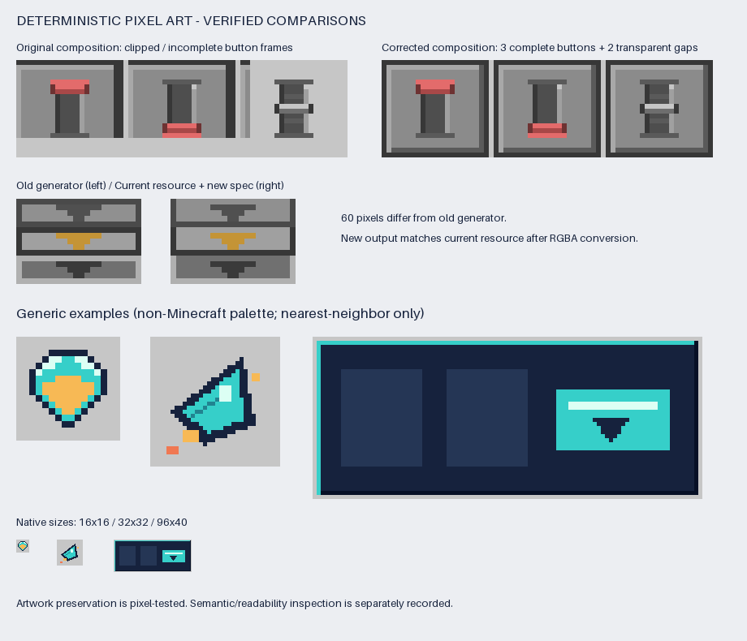

# 确定性像素资产

[English](README.md) · [MIT 协议](LICENSE) · [规格与 Python API](skill/deterministic-pixel-art/references/formats.md)

通过字符网格、整数绘图指令、像素蒙版和命名图集生成可编辑的 PNG。运行时只依赖 Python 与 Pillow，使用精确像素坐标与最近邻预览。Minecraft GUI 风格是可选预设。



## 快速上手

初始验证环境为 Python 3.14.2、Pillow 12.3.0。在仓库目录创建虚拟环境：

```sh
python -m venv .venv
```

Windows PowerShell 激活：`.\.venv\Scripts\Activate.ps1`；macOS/Linux shell：`source .venv/bin/activate`。

```sh
python -m pip install -r requirements.txt
python src/pixel_art.py render --spec examples/gem-16.json --out output/gem.png --preview output/gem-preview.png
python src/pixel_art.py validate --image output/gem.png
```

在其他工作目录执行时，为脚本、输入和输出使用绝对路径。已有输出默认拒绝覆盖，需要有意覆盖时使用 `--force`。

## 选择示例

| 示例 | 用途 |
|---|---|
| [gem-16.json](examples/gem-16.json) | 自定义调色板、镜像的 16×16 精灵 |
| [asymmetric-ship-32.json](examples/asymmetric-ship-32.json) | 多边形构成的 32×32 非对称精灵 |
| [generic-panel-96x40.json](examples/generic-panel-96x40.json) | 非 Minecraft 配色的通用 GUI |
| [minecraft-button-states.json](examples/minecraft-button-states.json) | 五种命名按钮状态组成的图集 |

规格与 PNG 一起保存。检查原尺寸与放大预览；尺寸和像素断言不能代替对方向、状态语义和辨识度的判断。

[格式说明](skill/deterministic-pixel-art/references/formats.md)包含 JSON v1、简短 GUI DSL、`render(spec)`、`Canvas`、校验规则与图集元数据。未知符号、未知指令、隐式裁切会明确报错。矩形坐标统一为 `x, y, width, height`。

## 作为 Codex Skill 使用

[skill/deterministic-pixel-art](skill/deterministic-pixel-art/SKILL.md) 是独立分发目录，包含运行时、示例、参考说明与 MIT 许可。将整个目录复制到 Codex 的 skills 目录（`$CODEX_HOME/skills`，默认 `~/.codex/skills`），并在任务可用的 Python 环境中安装该目录的 `requirements.txt`。

调用示例：“使用 `$deterministic-pixel-art` 创建四个 16×16 方向图标，放入有状态名称的横向图集，保留一像素透明边距，并生成放大预览。”

安装开发依赖后运行 `python -B tools/check.py`，可生成经过测试的 ZIP。压缩包在本地生成，不提交到仓库；检查过程不安装全局 Skill。

## 实测收益与代价

初始 Windows 评估中，43 张历史图有 40 张逐像素保持。3 张有意变化修复了不完整的按钮合成，或将 footer 对齐实际使用中的资源。

| 纯渲染场景 | 原版 → 新版中位耗时 | 倍率 |
|---|---:|---:|
| 128×48 面板 | 1.3364 → 0.1519 ms | 8.80× |
| 16×16 方块面 | 0.3214 → 0.1032 ms | 3.11× |
| 80×16 图集 | 0.5105 → 0.4381 ms | 1.17× |

以上是单一环境实测，不含进程启动和磁盘 I/O。相同产物的完整命令**慢了 47.03 ms（+35%）**；图集尾部耗时及部分 Python 分配峰值也增加。未测量 token 节省、模型修正轮次或游戏内质量。详见[完整报告](docs/optimization-report.zh-CN.md)和[实测 JSON](docs/measurements/metrics.json)。

这些资产的纯渲染已低于一毫秒，继续压榨速度的绝对收益有限。批量 CLI 可能改善反复启动的成本，但尚未实现或实测。当前发布整理侧重可移植测试与可复现打包。

## 开发检查

```sh
python -m pip install -r requirements-dev.txt
python -B tools/check.py
```

检查包含 24 个单元测试、43 张逐图回归、86 个冻结夹具文件的完整性校验、基准测试、可复现 ZIP 打包及 19 项独立目录包执行检查。工作目录含中文和空格，不依赖原模组路径或 Codex 安装；产物写入被 Git 忽略的 `output/` 与 `evaluation/`。

如有 skill-creator 官方校验器，可追加执行：

```sh
python -B tools/test_skill.py --python /path/to/python --validator /path/to/quick_validate.py
```

默认内置的项目校验器检查元数据与引用，不冒充官方校验器。GitHub Actions 配置了 Windows、Ubuntu 和 Python 3.14；配置存在不等于已在相应平台通过。

`src/` 是运行时源码，`skill/` 是生成的分发版本，说明文字源位于 `tools/package_skill.py`。修改 `src/` 后运行检查来同步 Skill。`baselines/` 只保留必要历史夹具，见[来源说明](docs/PROVENANCE.md)；原项目完整保护档案保留在仓库之外。

## 协议

仓库及独立 Skill 使用 [MIT](LICENSE)。Pillow 和仅开发使用的 PyYAML 通过依赖安装，不随仓库捆绑。
