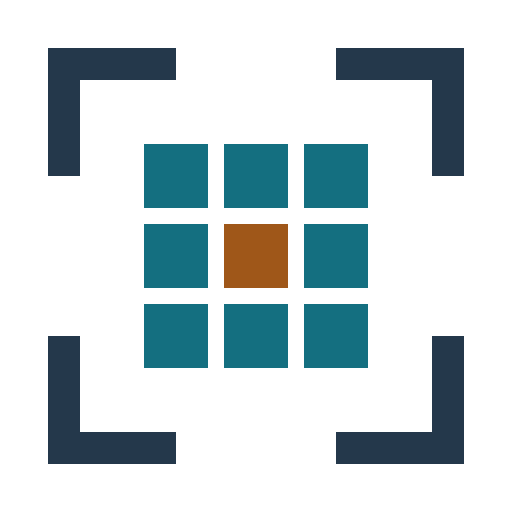

# Pixel Anchor Logo 素材包

五种尺寸、六种外观，大尺寸徽章默认使用已选定的增强版。[English](README.md)

## 怎么选

| 用途 | 版本 |
|---|---|
| 使用深底徽章 | [32](badge-dark/pixel-anchor-32.png)、[64](badge-dark/pixel-anchor-64.png)、[128](badge-dark/pixel-anchor-128.png)、[256](badge-dark/pixel-anchor-256.png)、[512](badge-dark/pixel-anchor-512.png) |
| 使用浅底徽章 | [浅底徽章目录](badge-light/) |
| 放在深色背景上，不带底板 | [深色背景用透明图形](mark-dark/) |
| 放在浅色背景上，不带底板 | [浅色背景用透明图形](mark-light/) |
| 只使用黑色 | [纯黑透明图形](mono-black/) |
| 只使用白色 | [纯白透明图形](mono-white/) |

每套都提供 32、64、128、256、512 五种尺寸，共 30 张 PNG 和 30 份独立可编辑 JSON。

## 细节与尺寸

32/64/128 徽章使用简洁版；256/512 徽章默认使用增强版，为边框、定位角和色块补少量明暗边缘。
外轮廓、九格布局和中心强调格保持。每个外观、每个尺寸只有一份推荐文件，不必再挑基础或增强。
透明图形与纯黑/纯白版本在所有尺寸下都保持平面简洁。

所有放大均使用整数倍最近邻，不模糊。紧凑界面请选择 32/64/128，不要把增强版缩成小图标。
深底 32/128 PNG 与 v1.2.1 Skill 图标逐字节相同。素材不含文字、渐变或外部字体。

快速查看：[六种外观](preview/themes.png)、[推荐尺寸对照](preview/default-sizes.png)。

## 深浅主题怎样切换

透明图形没有底板；徽章有实色内部和透明角点。纯黑/纯白各只有一种可见颜色，不是灰度图。
PNG 本身不会感知系统主题，需要网页或应用选择对应图片。网页可使用：

```html
<picture>
  <source media="(prefers-color-scheme: dark)" srcset="mark-dark/pixel-anchor-512.png">
  
</picture>
```

想让像素边缘保持清晰，可设 `image-rendering: pixelated`，并按整数倍尺寸显示。

## 重绘与校验

已有兼容的 Skill 和 Python/Pillow 时：

```sh
python <skill>/scripts/pixel_art.py render --spec badge-dark/pixel-anchor-512.json --out rebuilt.png
```

[manifest.json](manifest.json) 标明简洁/增强选择及文件和 RGBA 像素摘要；[SHA256SUMS.txt](SHA256SUMS.txt) 用于核对包内文件。
原创图形使用 [MIT 协议](LICENSE)。完整素材包作为独立 Release 下载附件，Skill 本身只需带 32/128 图标。
