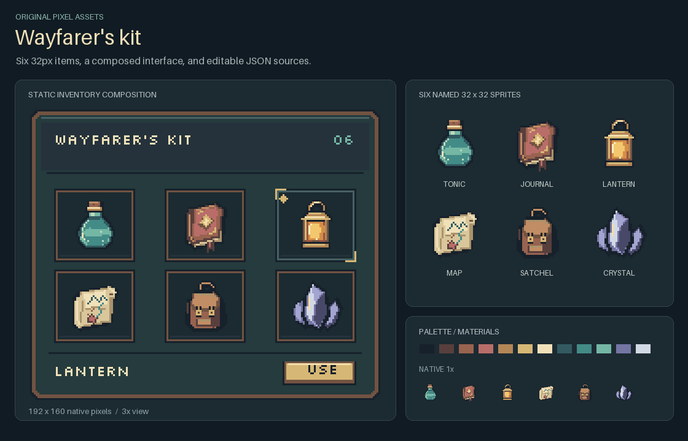
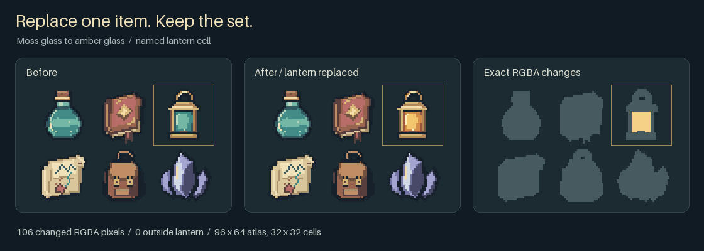

# Wayfarer's kit / 旅行用品示范

Six original 32×32 sprites, with a consistent upper-left light and a shared palette: glass tonic, leather journal, brass lantern, parchment map, satchel and crystal. The static 192×160 inventory composition shows them at their intended native scale. The overview also includes a 1× row; all larger artwork views use integer nearest-neighbor scaling.



六件物品不是从网络下载的素材；轮廓、材质、光照与配色均在 [build.py](build.py) 中用整数绘图指令编写。可直接使用单件透明PNG，或继续编辑完整JSON图集和绘图脚本。这里展示的是静态界面组合；浏览器输入与实际按钮交互另见[UI应用示范](../pixel-ui/README.md)。

## Sources and outputs

- [after.json](assets/after.json) and [after.png](assets/after.png): a 96×64 atlas, six named 32×32 cells; `tonic`, `journal`, `lantern`, `map`, `satchel`, `crystal`.
- Individual transparent PNGs: [tonic](assets/tonic.png), [journal](assets/journal.png), [lantern](assets/lantern.png), [map](assets/map.png), [satchel](assets/satchel.png), [crystal](assets/crystal.png).
- [panel.json](assets/panel.json): the reusable UI frame without text or item images. [ui.json](assets/ui.json) and [ui.png](assets/ui.png): the composed example, including the rasterized example labels.
- [manifest.json](assets/manifest.json): source/font hashes and generated-file checksums. Layout sidecars and embedded PNG records identify the atlas and its pixels.

Change the named palette roles or individual drawing functions in `build.py` to make a variant. The lantern uses separate glass palette roles; changing those does not repaint the brass frame. The drawing script regenerates the JSON, PNGs, layout, verification and presentation images together. Output publication uses the existing library behavior; no overwrite without explicit `--force`.

## Rebuild

From the repository root, with its Python/Pillow requirements installed:

```sh
python demos/travel-kit/build.py --out-dir output/travel-kit
```

Use a fresh output directory for another candidate, or explicitly add `--force` when rebuilding outputs that you intend to replace. The script does not write into the installed Skill, change runtime code or rebuild release packages. It runs from any current directory when invoked by its absolute path.

## Replace one named item



The green-glass lantern becomes amber glass. **106 RGBA pixels change inside `[64,0,32,32]`; zero change outside.** Shape, brass parts, names, cell order and the other five items stay the same. This demonstrates the existing stable import/replace-cell/verify workflow; it does not depend on unreleased commands.

```sh
python src/pixel_art.py import --image demos/travel-kit/assets/before.png --metadata demos/travel-kit/assets/before-layout.json --out output/travel-edit/source.json
python src/pixel_art.py replace-cell --spec output/travel-edit/source.json --cell lantern --replacement demos/travel-kit/assets/lantern-amber.json --out output/travel-edit/candidate.json --image-out output/travel-edit/candidate.png --metadata output/travel-edit/layout.json
python src/pixel_art.py verify --image output/travel-edit/candidate.png --compare demos/travel-kit/assets/before.png --allow-region 64 0 32 32
```

The editable candidate rerenders to the same pixels as the included `after.png`. Importing a PNG does not reconstruct original objects/layers; use the authored drawing specs or generator when you want meaningful palette/shape edits.

## License and interpretation

Artwork and code use the repository's [MIT license](../../LICENSE). Example UI labels reuse unmodified Silkscreen Regular, with its [SIL OFL 1.1 license](../pixel-ui/fonts/OFL.txt) and [source record](../pixel-ui/fonts/source.json). The font remains in the existing font directory and is not copied into the standalone Skill.

These are author-created demonstration assets and an author visual review, not a new external model trial, game integration test, or proof of general quality, correction or efficiency gains. The UI is a static composition. The finite pixel checks establish size, alpha, reproducibility and edit boundaries.
