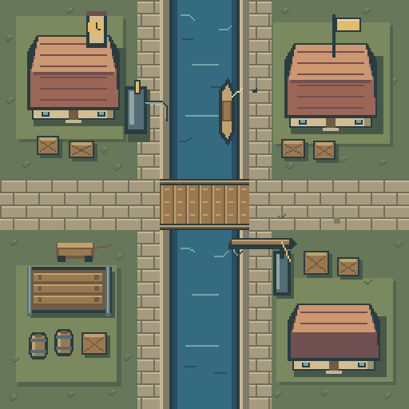
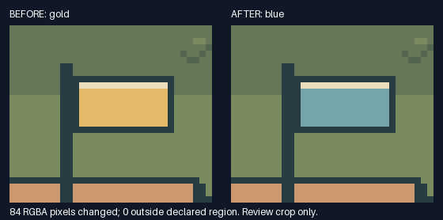

# P4a：独立256分块结果

2026-10-23。**四个128×128局部绘制已完成，拼合为256×256“运河工坊路口”。** [运行入口](../demos/chunk-scene/README.md) · [英文摘要](chunk-scene-report.md) · [机器记录](measurements/chunk-scene.json)。

主计划共4阶段：P1已分发、外部结果待回；P2/P3完成；**当前位置P4a（独立256）完成本地验收**。下一项是P4b原生512的需求/收益评估；只有本阶段通过且新增分辨率确有用途才绘制。四阶段到达最后一项，不等于P1外部验收完成。

## 分块证据与收益

- 在编写四块前，提交 `7506d55` 冻结了简化构图、调色板、左上光源、6px建筑正面、全局纹理相位与边界所有权。合同SHA-256为 `f2bf1e01d6d466f83dbaa62465808cde7c55494abe799875099e85973889745a`。
- `chunk_nw/ne/sw/se.py` 各自返回一个128画布的绘制规格，分别声明局部地形、道路、水面、桥段与专属物件。共享代码只提供原语、局部材质图案和小物件，不生成完整场景。最终完整图首次出现在四块产物完成之后。
- 首次四条独立命令的PNG/规格/布局保留在本地。隔离演练又分别只提供“该块源码+共享辅助+合同+src运行时”，没有其他三块源码或任何完整图输入；四份结果与首次产物逐字节一致。
- 现有 `assemble` 以 `copy` 拼合，覆盖65,536像素、无空洞/重叠、四条接缝。逆序放置所得RGBA一致。原生256由绘图产生，不是放大128，也不是从整图裁切重组。
- 能单独修改一个有意义的部件并证明保留范围。新加的 `--flag` 入口让完整输出/清单随参数一起刷新；独立块入口可只重建NE。没有修改运行时格式、核心API或引入新依赖。

源配方比展开JSON更适合编辑，但文件大小不等于token、命令耗时不等于创作耗时。机器记录列出实际字节、行数与命令结果，不推算模型生产力。

## 接缝与视觉观察

水道宽40px，桥整体56×32，净桥面24px高，上下栏杆各4px。桥面、栏杆、铺砖通路与波纹均跨越x/y=128，不能只让单色背景碰边。预检执行1,140次材质/相位像素断言（含固定锚点复查）；它不替代看图，也不是整图质量覆盖率。

实际查看了原尺寸、2倍图、灰度、8段有全局坐标的接缝视图和中心交点。观察到：

| 项目 | 作者代理观察 |
|---|---|
| 水道/波纹 | 两岸宽度、暗水带和跨中线高光延续；上游/下游都能辨认，没有在边界产生人工黑框 |
| 桥/道路 | 铺砖相位接续，桥板接缝与纹理连续；栏杆沿南北边缘，未横挡东西方向的24px桥面 |
| 体积/材质 | 建筑墙高、屋顶分面、左上高光与右下投影同一约定；木、水、石、金属用不同纹理组织 |
| 整体与局限 | 四块有不同物件，主桥路口清楚；布局规整且装饰较克制，尚非复杂地形/大型跨块建筑的验证 |

[原尺寸](../demos/chunk-scene/assets/scene.png) · [接缝拼板](../demos/chunk-scene/assets/seams.png) · [中心交点](../demos/chunk-scene/assets/center.png) · [灰度](../demos/chunk-scene/assets/grayscale.png) · [仅矩形布局草图](../demos/chunk-scene/assets/layout-sketch.png)。

没有发现需要局部重绘的关键断裂，因此本次视觉修正为0轮，没有人为制造“改前更差”的对照。首次预检曾将y=160、x=134..139的6个水面高光误判，原因是检查器要求纯底色；合同允许水面材质变化，修正检查条件后通过，合同和绘制像素不变。这个例子说明规则过严也会制造返工。

## 单块小改与失配检测

演练需求是为右上包裹站生成蓝色路线旗帜变体，保留建筑、桥、水道和其他块。只运行NE配方，重拼并独立重渲染该JSON：

- 改变84个RGBA像素，全部在全局 `[210,11,16,9]` 内，允许区外0变化。
- 其他三块PNG字节哈希不变；边界/相位检查仍通过。
- 完整构建器的同参数产物与独立块重拼结果逐像素一致，清单记录旗帜参数。
- 独立中文空格目录共14条实际命令，0意外失败；3次预期拒绝分别为未授权覆盖、注入NE一像素横移、将NE放到x=129导致越界。拒绝均保留原文件；错误像素与错误放置分别归因。
- 同色表内将铺砖接缝改错的单元测试也被锚点检查检出。几何拼合成功与材质/语义连续是不同检查。

## 工程与版本

本轮完整检查通过94项源码测试（新增5项）、43张稳定图、历史夹具/研究基线、77项独立ZIP场景及重复打包一致性。最后新增批量旗帜参数后，又运行全部5项本阶段测试；最终实现由本提交CI复查。10张既有外部最终图/布局、138个保护文件另行核对。完整日志在忽略的 `evaluation/chunks-20261023/`，不是新外部反馈。

Skill ZIP仍为222,984字节/91文件，SHA-256 `b680e73c966eb6557ed94bfc2e843dd4fca2c74c8aaf5f279caa2eeece6f308d`；不变包沿用P2官方格式校验结果，本轮不重复。示例仅放仓库，不替换原工具、模组资源、公开rc.2、封存rc.3或已安装v1.1.1。

最终实现 `a6d84936618b5176c5eecffcea6accd8ec4b745e` 已推送，[CI运行39981625213](https://github.com/Chenamel/deterministic-pixel-art/actions/runs/39981625213)的8组全部成功，包含Windows/Ubuntu完整主流程和各自Pillow10.4/11.3/12.1兼容检查，已覆盖最后的批量参数代码。另行实际调用批量flag CLI，与独立块修改/拼合像素一致、清单参数正确。逐组记录见 [chunk-scene-ci.json](measurements/chunk-scene-ci.json)。视觉观察仍为本地作者自评，不声称CI替代审美验收。

## 未证明与下一项

这是同一作者代理按合同分别绘制并自评，**不是多模型盲作、独立审美评测或普遍画质提升证明**。未做游戏内导航/碰撞、复杂曲线地形、跨块大型建筑、不同模型之间风格收敛或原生512验证；像素覆盖检查不能证明可走性。

下一项P4b先问原生512能新增什么真实表达/编辑价值，再确定新场景和块数；不得把256最近邻放大作为结果，也不因“支持更大画布”自动扩展。若没有明确收益，优先收口：将P3/P4经验整理成Skill按需指导和最小示例，形成新的候选包，并继续P1外部回收/既有稳定发布门槛，不无期限增加命令。阶段完成的直接回复固定报告“总阶段、当前位置、下一项、外部等待”。
