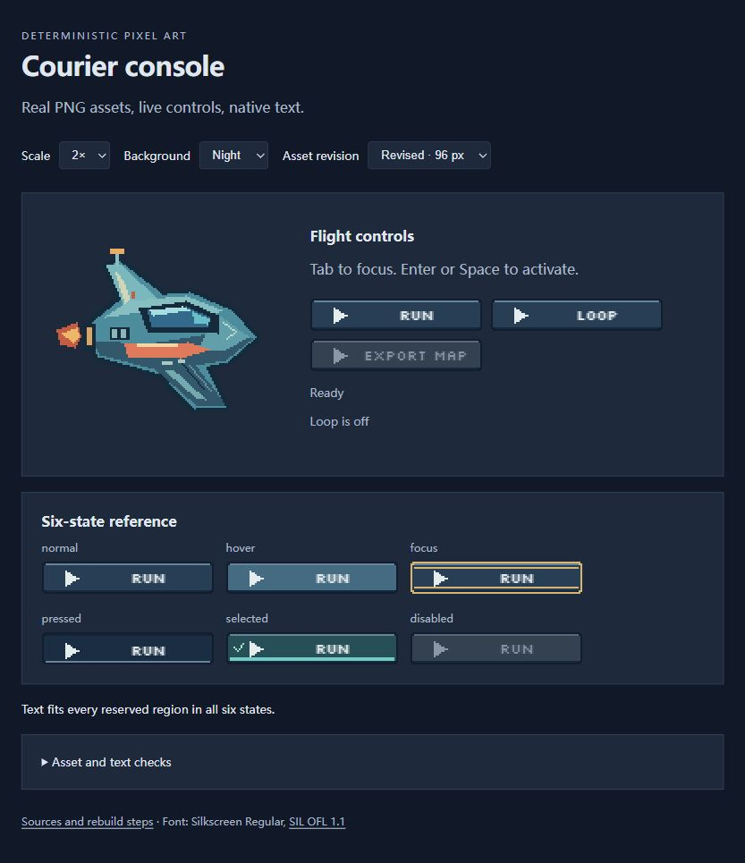

# P3: real PNG, font and interactive consumer

2026-10-23 · **Local consumer demonstration completed.** [Detailed Chinese report](consumer-ui-report.zh-CN.md) · [Measurements](measurements/consumer-ui.json) · [Run/rebuild instructions](../demos/pixel-ui/README.md).

The repository-only demo loads real named PNG atlas cells, renders labels with the bundled Silkscreen Regular font at 8px and uses native HTML buttons for input. No browser/npm dependency is added to the renderer or Skill.

The actual `EXPORT MAP` glyph width is 58px. The baseline 64px button reserves 30px: all six states fail the bounds check, and the screenshot shows icon overlap and right clipping. A recipe width change to 96px reserves 62px; all 18 label/state checks fit, without shrinking the font or icon. Each button now costs 32 additional logical pixels, so fixed-size consumers must budget for the wider control; this demo allows wrapping.

[Baseline screenshot](consumer-ui/baseline.jpg) · [Selected with keyboard focus](consumer-ui/selected-focus.jpg) · [Native size](consumer-ui/night-1x.jpg) · [Paper at 3×](consumer-ui/paper-3x.jpg).

Actual browser checks covered mouse/Enter/Space activation, hover, held press, release, drag-out cancellation, persistent selection with an independent focus outline, disabled click suppression and keyboard skipping. Both backgrounds at 1/2/3× retain text fit and nearest-neighbor PNG display. Full-page and native-size views were inspected, including the six-state gallery. No console warnings/errors were observed on final load.

A further 112px/`START` configuration exposed hard-coded initial CSS width, option text and gallery label. These now follow the manifest. The rebuilt browser displayed 224×36 at 2× with matching names and layout. Restoring the default 96px configuration restored all 13 generated files byte-for-byte. The consumer verifies asset hashes and uses named layout/text reservations rather than hand-copied UVs.

The portable pipeline passes 89 source tests, 43 stable-image regressions, historical fixture/study integrity checks, 77 isolated ZIP cases and reproducible packaging. Three new tests cover width/spec/layout consistency, Unicode/space paths, partial-output overwrite refusal, explicit restoration and invalid configurations without outputs. A Windows stderr-encoding failure was found and fixed during testing. This round did not rerun the official Skill validator because the distributed contents are unchanged from its validated P2 package.

Implementation commit `1f24256584e491a054c6bafd825383850b8f0b68` is pushed and [all eight CI jobs](https://github.com/Chenamel/deterministic-pixel-art/actions/runs/39934535393) pass, covering Windows/Ubuntu and Pillow 10.4/11.3/12.1. CI checks Python/generator/packaging behavior; actual browser checks were local. [Per-job record](measurements/consumer-ui-ci.json).

The Skill ZIP remains 222,984 bytes/91 files, SHA-256 `b680e73c966eb6557ed94bfc2e843dd4fca2c74c8aaf5f279caa2eeece6f308d`. Stable/local installation remains v1.1.1, published candidate rc.2 and local sealed recipe candidate rc.3. No new external follow-up submissions were received.

This is author-agent review in one browser environment, not independent aesthetic evidence, general productivity measurement, cross-browser/mobile/accessibility certification or game acceptance. Latin labels only were checked; no Chinese or Minecraft font acceptance is claimed. Silkscreen is separately licensed under SIL OFL1.1, with unmodified font/license and source hashes retained in the demo. Code/original art remain MIT. Screenshots demonstrate this consumer rather than general art-quality gains.

Next is the approved P4 independently authored 256px scene: freeze shared direction and edge ownership, draw separate chunks, inspect semantics and seams, and retain at most two targeted repair rounds. Crop/reassembly controls do not count as independent authoring; 512px follows only after that workflow succeeds.
