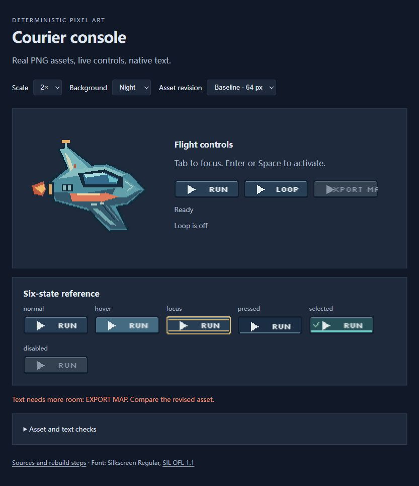

# P3：真实 PNG、字体与交互闭环

2026-10-23。**本地浏览器示例已完成。发现并修正一项实际文字适配问题；未修改渲染核心或分发 Skill。** [英文摘要](consumer-ui-report.md) · [机器记录](measurements/consumer-ui.json) · [示例与重建说明](../demos/pixel-ui/README.md)。

## 实际收益

此前配方只声明文字留区，没有用真实字体证明能放下内容。本次用 Silkscreen Regular 8px 在实际浏览器画布绘字，载入真实 PNG 命名图集，再以最近邻整数放大。页面使用原生 HTML 按钮接收鼠标、Tab、Enter 和 Space；PNG 不负责交互。

| 相同标签 `EXPORT MAP` | 64px 基线 | 96px 修正 |
|---|---:|---:|
| 实测字形宽度 | 58px | 58px |
| 每格文字留区宽度 | 30px | 62px |
| 字形左边界 | 14px，侵入图标区域 | 30px，位于留区内 |
| 六态的适配失败数 | 6 | 0 |
| RUN / LOOP / EXPORT MAP × 六态 | 12/18 项适配 | 18/18 项适配 |

宽度从配方生成，保留边框、状态顺序与图标尺寸；文字没有被缩小。代价是每个按钮增加32px逻辑宽度，三按钮横排需要更多空间。示例通过换行处理；不能把改宽当成适用于所有固定布局的自动修复。

## 已实际检查

| 检查 | 观察结果 |
|---|---|
| 资源与字体 | PNG/JSON/TTF 的 SHA-256 匹配，命名图集顺序与尺寸正确；实际字体成功载入，不使用回退字体作适配证据 |
| 激活 | 鼠标点击、Enter、Space 分别让 RUN 计数增加1；LOOP 可切换 `aria-pressed` |
| 按下与取消 | 悬停、持续按下、释放的 PNG 状态正确；移出后释放不激活动作 |
| 选中与焦点 | 勾选/底线保留，同时显示独立的键盘焦点外框，未用焦点贴图覆盖持久选中状态 |
| 禁用 | EXPORT MAP 实际 disabled；点击没有新动作，Tab 从 LOOP 跳到下一可用控件 |
| 背景与缩放 | Night/Paper 各1/2/3倍，按钮显示96×18、192×36、288×54 CSS像素；字形适配不变，PNG用 `image-rendering: pixelated` |
| 原尺寸与全套 | 查看1倍原尺寸、深浅背景、六态图库，以及选中+焦点截图。未只依赖检查面板的JSON |

实际检查时视口约848×719 CSS像素，按钮矩形测量有约1e-5px浮点误差。整数CSS缩放不等于已验证任意系统DPI、浏览器缩放或触摸设备。

[选中+焦点](consumer-ui/selected-focus.jpg) · [按下](consumer-ui/pressed.jpg) · [原尺寸深色](consumer-ui/night-1x.jpg) · [原尺寸浅色](consumer-ui/paper-1x.jpg) · [3倍深色](consumer-ui/night-3x.jpg) · [3倍浅色](consumer-ui/paper-3x.jpg)。

## 一次修改后的全链路

1. 制作64px基线并接入真实标签、字体，截图与字形边界确认溢出。
2. 将按钮宽度设为96，重建 PNG、可编辑规格、布局与文字留区；浏览器重载后复查18项适配。
3. 为验证后续修改路径，另用112px和 `START` 标签配置重建。发现并修正页面初始CSS宽度、下拉选项和图库标签写死的问题；修正后界面读取manifest，实测显示224×36（2倍），图集单元宽112，图库及按钮名称均更新。
4. 恢复96px默认配置并重建，13个生成文件逐字节回到探测前状态；再次重载，字体、图集、文字适配通过，未发现控制台警告/错误。

生成器 `tools/build_consumer_demo.py` 复用 `recipes/`，所有输出先准备再由已有发布器暂存/提交。新例子加入 `tools/check.py`，不是手绘截图或手抄UV。manifest记录源配方、参数及产物哈希，消费端按名称选格并读取文字留区。清单可发现旧PNG/新布局混用，不提供来源认证或掉电事务保证。

## 工程检查与保留项

- 本轮 `python -B tools/check.py` 通过89项源码测试、43张稳定图回归、86份历史夹具与八项冻结研究完整性、77项独立ZIP场景和重复打包一致性。
- 新增3项生成器测试，覆盖112px尺寸/布局/文字留区及规格重渲染、独立中文空格路径、部分文件缺失时拒绝覆盖、显式重建还原、错误配置不留下产物。首次测试发现Windows错误输出编码问题，改用ASCII兼容JSON后通过；失败保留在开发记录。
- 10张已有外部最终PNG与布局仍精确匹配，138个受保护原工具/资源/输入文件哈希不变。这里重新核验的是旧输入，不是新增外部测评结果。
- Skill内容不变，重新打包仍为222,984字节/91文件，SHA-256 `b680e73c966eb6557ed94bfc2e843dd4fca2c74c8aaf5f279caa2eeece6f308d`，与封存rc.3一致。本轮未重复官方Skill格式校验；其P2结果与不变包可追溯。
- 示例、字体与截图仅进入仓库，不增加Skill或核心的浏览器/npm依赖。稳定发布和本地安装仍v1.1.1，公开候选仍rc.2，本地rc.3保持封存。P1三项外部复测仍无新返回。
- 实现提交 `1f24256584e491a054c6bafd825383850b8f0b68` 已推送，[CI运行39934535393](https://github.com/Chenamel/deterministic-pixel-art/actions/runs/39934535393)的8组全部成功，包含Windows/Ubuntu主流程及Pillow10.4/11.3/12.1兼容矩阵。它验证生成器/运行时/打包；本地浏览器检查单列，不声称CI完成浏览器验收。逐组结果在 [consumer-ui-ci.json](measurements/consumer-ui-ci.json)。

## 适用范围与下一项

这是单一浏览器环境中的作者代理工程/视觉检查，证明本例的文字适配和实际交互可用，不是独立审美评测、通用生产力测试或普遍画质提升。字体支持本例拉丁标签，未完成中文字体、Minecraft字体或游戏内验收；未声称无障碍认证、跨浏览器或移动端验收。像素绘制、浏览器绘字、实际游戏表现分别记录。

字体为未修改的Google Fonts Silkscreen Regular，按SIL OFL1.1附带许可和来源；项目代码/原创图像仍MIT。字体不随Skill捆绑。来源记录在 [fonts/source.json](../demos/pixel-ui/fonts/source.json)，许可在 [fonts/OFL.txt](../demos/pixel-ui/fonts/OFL.txt)。

下一项按已批准顺序推进P4：先冻结全局风格、边界所有权和跨块结构，再分别编写四个128px块组成256px场景。保留真正独立绘制与最多两轮接缝修正证据，不能将整图裁切重组当作独立分块；通过后再考虑512。现有大JSON编辑入口、实际字体与消费端闭环已形成可重复检查点，不先增加新绘图语法。
