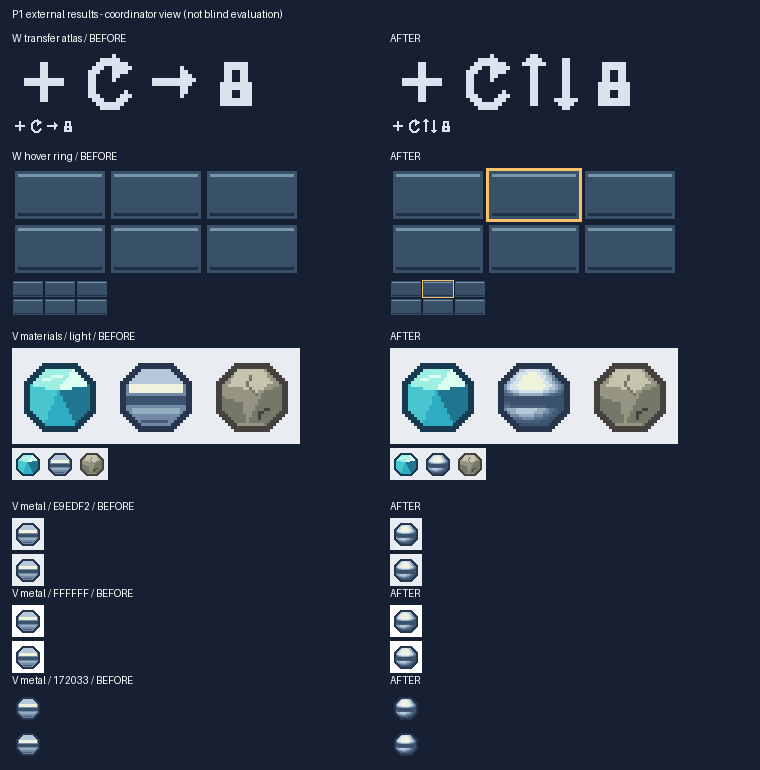

# P1三平台定向复测：核验与改进

日期：2026-10-25。工具基线是三个任务包内冻结的 **v1.2.0-rc.2**，不是用户收集目录的名称。开发起点 `e66d87d`，分支 `codex/visual-quality`。本轮收到全部三份提交及7份过程/反馈文件。

**结论：三个任务的已提交工程产物通过独立核验，未发现新的核心像素错误；确有可减少手工拆格的易用性改进。** 这不是旧版/新版受控A/B，不能据此宣布普遍画质、效率或token收益。新入口封存为独立本地候选 **v1.2.0-rc.5**；稳定安装维持v1.1.1。

## 核验了什么

外部附带代码只作证据，没有直接执行。协调端使用哈希匹配的本地冻结运行时和当前源码，独立解析规格、重建PNG并比较解码RGBA、布局、摘要及允许修改区；还实际查看原尺寸、最近邻放大、背景和剪影图。原始提交与完整会话只保存在被忽略的本地 `evaluation/p1-results-20261025/`，不进入Skill或公开Git。

| 任务与日志所示模型 | 记录环境 | 命令数 | 独立核验结果 |
|---|---|---:|---|
| P1-W / Deepseek-V4.1-Flash，WorkBuddy | Windows；Python3.13.14 / Pillow12.3.0 | 31 | 图集改70个RGBA像素；hover空心边框改96个；各自区外0，布局及最终图精确重建 |
| P1-C / qwen3.8-max，千问 | Linux；Python3.12.3；Pillow13.0.0后切到任务内12.3.0 | 5 | 版本拒绝、原生写入EPERM、显式便携输出和防覆盖均有记录；PNG/背景预览精确匹配 |
| P1-V / Gemini | Linux；Python3.11.2 / Pillow11.1.0 | 17 | metal改195个RGBA像素，区外0，alpha/剪影轮廓不变；浅底审阅卡实际有可见黑色剪影 |

合计 **53条命令**。5次非零退出均有明确原因：W第7条、C第4条、V第17条为防覆盖；C第1条为Pillow13版本范围拒绝；C第2条为原生发布硬链接EPERM。没有自动添加 `--force`。不将预期拒绝记成渲染失败，也不从这些计数计算模型排名或创作成功率。

归档的 **13组规格/PNG逐像素一致**；三张编辑最终图在冻结rc.2和当前rc.5均精确重建。拒绝覆盖前后已有文件哈希保留；导入基线规格重建了原始冻结像素。声明的task/Skill摘要与冻结任务一致，但submission仅含RUN，没有远端完整runtime供独立重哈希，不能把日志声明写成远端工具文件已独立核验。

## 图像复查与限制



- W的左右并排上/下箭头可辨，hover金色空心环包含角点，内部未改。原任务“上下两条相反方向”混合了方向与排列含义，不据此追罚参与者；后续模板才明确“左↑右↓，左右并排”。
- V的metal高光与体积更圆润清楚，同时从硬水平色带转向较柔和的层级；这是具体风格取舍，不能直接称为所有项目的提升。相邻材质单元保持原样。
- C的面板和目标背景 `E9EDF2` 完整；V的前后浅底剪影都实际可见。离线查看不等于游戏内/独立盲评。

上述判断属于参与者自评加协调端作者复查。各模型没有配对运行新旧版，候选/修正次数也不同；不能把运行耗时之和当作完整创作耗时。真实token不可得时保留空值，没有新证据证明减少模型轮次、token或时间。

## 反馈取舍

| 反馈 | 核验与处理 |
|---|---|
| 为一个单元导入完整图集，再手工找格/复制replacement | 确认使用成本；rc.5增加可选 `import --cell NAME`，直接得到可编辑单格 |
| 独立单格的metadata没有atlas，需要手造sidecar | 单格render无atlas正确；`replace-cell --metadata`本就输出完整atlas和新摘要，补明用法，未修改元数据语义 |
| 反复占用final路径触发防覆盖，后续有更好候选 | 保留拒绝覆盖；说明每个候选独立目录、定稿后交付、经授权后可明确重建，不自动加force |
| 新颜色后符号“移动” | 符号按精确RGBA排序，新增颜色可重映射；补同一规格palette和局部零起点说明，不采用“按频次分配”的错误解释 |
| 千问称RUN外命令无法记录 | 可信冻结记录器受控复现反证：命令/环境/退出码正常记录，只有自动产物哈希限RUN；补模板说明 |
| 原生输出在云挂载失败，换/tmp成功 | EPERM有命令证据；挂载仅自报ossfs2，身份未知；/tmp成功只有笔记，无相应命令/PNG，保留为自述，不标为独立复现 |
| Gemini文字称第15条失败 | JSONL实际为第17条，以原始命令记录为准 |
| 重复状态告警、token空值 | 重复状态是既有测试输入问题，不静默隐藏；token不可得留空原协议已支持 |
| 新旋转语法、自动编号、小图库、palette锁定、多倍率并排卡 | 暂缓；当前已有实现路径，尚无足够证据证明新增接口优于简短说明和选格入口 |

## rc.5改进及实际闭环

```text
python <skill>/scripts/pixel_art.py import --image atlas.png --metadata layout.json --out editable.json
python <skill>/scripts/pixel_art.py import --image atlas.png --metadata layout.json --cell metal --out metal.json
# 编辑metal.json，再替换回完整图集：
python <skill>/scripts/pixel_art.py replace-cell --spec editable.json --cell metal --replacement metal.json --out candidate.json --image-out candidate.png --metadata candidate-layout.json
```

新公共API为 `image_to_spec(image, *, region=None, metadata=None, cell=None)`。先核对完整源图布局/摘要，再选择命名单格；输出本地坐标的grid/draw，不是一格atlas。支持sidecar、PNG内嵌或内存布局；保留隐藏RGB、半透明及超过62色的无损行段。未知名称、缺失/冲突/过期布局会在写入前拒绝；region/cell互斥。旧默认导入、JSON v1和绘制/合成语义保留。

协调端用本次V实际产物演练5条命令：整图导入、基线与最终图各导出metal、替换、验证；**0意外失败**，精确重建参与者最终图，195像素变化、区外0。完整导入规格5,857字节，选格规格1,551字节，选格内容与原手工提取一致。这证明省去查找/复制单元的步骤，字节差异不等于token或AI效率收益。

首次实现漏改公共懒加载转发包装，针对性测试中4项API调用失败；补齐参数后11项针对性测试通过。失败保留在开发日志，没有算作外部Agent缺陷。

## 候选验收与代价

- 103项源码测试、43张稳定迁移图回归、91项独立ZIP场景通过；官方Skill校验及另一个中文空格临时目录的实际导入/渲染通过。打包两次摘要一致。
- 10张历史外部最终图/布局仍精确；138个历史保护文件加本轮10个来源文件，合计148个哈希不变。冻结rc.2/rc.3/rc.4不覆盖，本地稳定安装仍1.1.1。
- rc.5 ZIP：97文件，231,561字节，较rc.4增加1,087字节（0.472%）。SHA-256：`2b9cb652fb9e4a50bd3e4d11e098003b86c6195a16c9b1730dbc6907839178a4`。本地目录 `dist/v1.2.0-rc.5/` 含包、清单、报告和检查记录；没有新稳定Release。
- 额外选格有全图摘要核验成本，本轮没有做新旧性能配对，未证明加速或零开销。未观察到旧绘图结果降级，不能据此保证所有环境/画风无退步。
- 当前实现的Windows/Ubuntu及Pillow多版本CI记录见后续 [p1-results-ci.json](measurements/p1-results-ci.json)；本地和实际CI证据分开。

[机器摘要](measurements/p1-results.json) · [候选验收数据](measurements/p1-candidate.json) · [后续阶段](next-stage-plan.zh-CN.md) · [恢复入口](../WORK_STATE.md)

## 总阶段与下一项

仍为4个主阶段：**P1三份已收且工程核验完成；P2可读配方完成；P3真实字体/交互完成；P4a独立原生256完成，P4b原生512因无具体需求暂缓**。当前为P1反馈处理及新候选收口，不另增第五功能阶段。

下一项是候选在真实项目中的使用和既有稳定版门槛核对，优先观察选格→局部修改→替换→消费端的阻碍。先前约定的八项配对任务/具体工作流收益没有被这三份短复测替代；证据不足时保留候选，不自动升级稳定或本地安装。原始云挂载、独立审美评价与游戏内效果仍未证实；512需明确消费端、原生细节或局部编辑需求才重启。
