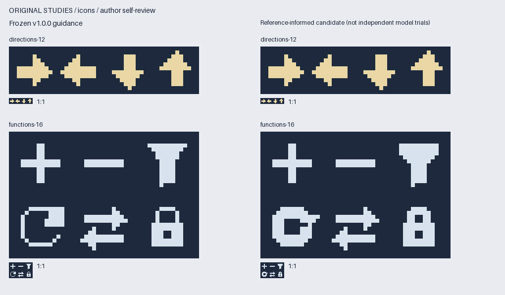
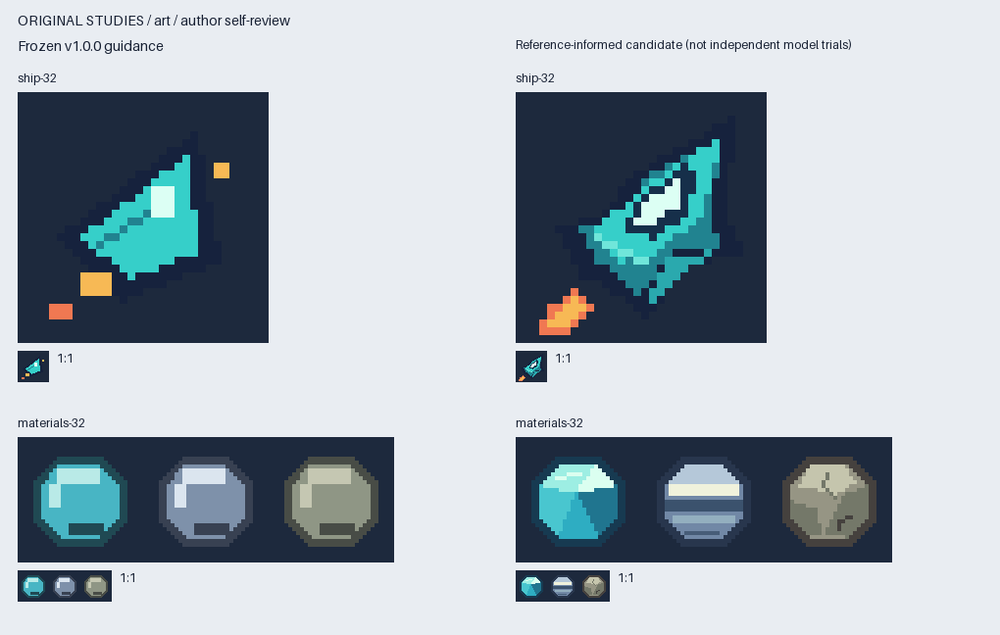
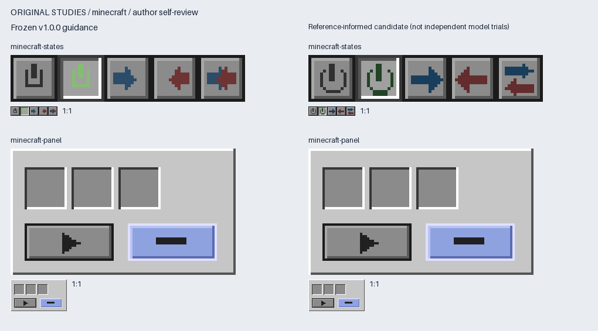

# 像素资产质量评估报告

[English](quality-report.md) · [机器可读记录](measurements/visual-quality.json)

八项前后对照的作者代理自评结果为六项改善、两项保持；在已检查的离线视图中，未发现方向含义、状态语义或关键内容预留的实质退步。v1.0.0 的 43 张迁移产物全部保持像素兼容。这是样本有限的作者自评，不能作为独立证据证明模型的通用审美能力提高。

## 方法与证据边界

使用 v1.0.0 指导完成并冻结基线后，再修改运行时和指导文档。前后采用相同需求、最多两个候选、最多两轮针对性修正；轮廓已明确的任务未强行用满预算。[冻结规格、PNG 和哈希](../quality/baseline/)、[任务需求](../quality/tasks.json)、[过程](../quality/process.json)、[未采用备选](../quality/drafts/)和[修正前版本](../quality/revisions/)均保留，检查不会静默重建基线。

创作者和评价者为同一代理，并提前知道拟改善方向；未随机化、未独立盲评，也不是独立模型对照实验。检查了原尺寸、最近邻放大、灰度、适用的剪影和上下文审阅图。自动像素检查能证明兼容性与契约，不能证明画面好看。教学对照为原创绘制，未打包教程图片、第三方 UI 包或 Minecraft 原版素材。

## 逐项结论与取舍

| 任务 | 自评 | 具体依据 | 取舍与限制 |
|---|---|---|---|
| 12×12 四方向图标 | 持平 | 轮廓、边距和视觉重量保留，像素完全相同 | 扁平风格无需强加明暗 |
| 16×16 六功能图标 | 改善 | 过滤器、锁和笔画重量更一致；刷新恢复曲线环与顺时针箭头 | 刷新变厚，细线项目可继续采用基线 |
| 32×32 非对称飞船 | 改善 | 座舱、尖机头与引擎共同指向右上；尾焰与机体剪影留缝 | 细节增加，不一定适合极简符号 |
| 32×32 同形三材质 | 改善 | 晶体切面、金属硬反光带、石材哑光面与裂纹在灰度下仍有区别 | 颜色与绘图操作增加 |
| 六状态按钮 | 改善 | 焦点外圈、选中勾与底线、按下图标位移与反向浮雕增强状态区别 | 装饰占用内边距，未验证长文字 |
| 96×64 通用面板 | 改善 | 导航选中、两组内容与主要操作形成层次 | 预留区不等于真实字体或翻译文本适配 |
| 16×16 Minecraft 五状态控件 | 改善 | 电源符号、开启标记和双向箭头分道更清晰 | 双向箭杆更小，未测 UV 和命中区域 |
| 96×54 Minecraft 组合界面 | 持平 | 槽位凹陷、按钮凸起与邻接边缘保留，像素完全相同 | 空余区域留给消费端内容 |

刷新图标和飞船各修正一轮。较宽飞船与较亮标题栏作为未选候选保留：前者挤占轮廓，后者与主要操作争夺注意力。另修正了对照拼图的行高，使原尺寸面板完整显示；此项仅改变展示，不修改资产。

## 耗时与投入

| 任务 | 基线渲染 ms | 候选渲染 ms | review 完整命令秒 | 候选数 / 修正轮次 |
|---|---:|---:|---:|---:|
| directions-12 | 0.4347 | 0.4206 | 0.172 | 1 / 0 |
| functions-16 | 0.3532 | 0.3686 | 0.175 | 1 / 1 |
| ship-32 | 0.1310 | 0.2453 | 0.167 | 2 / 1 |
| materials-32 | 0.2922 | 0.3614 | 0.176 | 1 / 0 |
| ui-states | 0.3795 | 0.5313 | 0.197 | 1 / 0 |
| ui-panel | 0.1272 | 0.2036 | 0.195 | 2 / 0 |
| minecraft-states | 0.6590 | 0.4278 | 0.202 | 1 / 0 |
| minecraft-panel | 0.2574 | 0.2267 | 0.182 | 1 / 0 |

渲染值来自创作记录中的单次本机测量，不是重复性能基准。review 包括进程启动、载入、诊断和写报告。模型总创作耗时及 token 未被仪器记录，保留为 null，因此不宣称工作流更快；部分细节更丰富的候选渲染更慢。此前渲染性能与完整命令、分配峰值退步见[历史报告](optimization-report.zh-CN.md)。本报告不使用画质提升百分比。

## 技术检查与行为变化

- 43 张稳定版输出的尺寸与 RGBA 哈希保持；八项冻结研究基线的文件和重新渲染像素也一致。历史上的 40/43 加三项有意修复属于此前迁移，不是本次新增变化。
- 33 个单元测试、实际 42 文件 ZIP 的 37 项独立目录执行场景通过。覆盖半透明、全透明、图集单元边界、预期孤点、重复状态、显式颜色对、错误上下文、比较及拒绝覆盖。
- 解包产物通过官方 Skill 校验器；在全新 Python 环境、无关的中文与空格路径运行。相同源文件重复打包的 ZIP 字节一致。运行依赖仍为 Python 和 Pillow；PyYAML 仅开发使用。
- 本地保护审计确认原工具与模组资源共 96 个保护文件全部未改；含机器路径的完整保护档案保留在仓库外。
- JSON v1、现有 Python 接口和旧命令保留。新增 `review` 为建议性工具：有效输入有提示也返回 0，无效输入返回 2，不修改原图；`validate` 继续负责明确契约。
- 对比度只检查声明的功能性前景/背景颜色对，先做 alpha 合成；默认 3:1 是有适用范围的参考，不套用到所有装饰像素和状态对。孤立像素、抖动及手工抗锯齿不被一律判错。

## 来源与发布范围

[Derek Yu 基础](https://www.derekyu.com/makegames/pixelart.html)及[常见问题](https://www.derekyu.com/makegames/pixelart2.html)用于轮廓、像素块和明暗组织；[Saint11](https://saint11.art/blog/pixel-art-tutorials/)用于规划、描边与材质；[Kenney](https://kenney.nl/assets/pixel-ui-pack)用于成套一致性和组件组织；[NN/g](https://www.nngroup.com/articles/visual-hierarchy-ux-definition/)用于视觉层次；[W3C](https://www.w3.org/WAI/WCAG22/Understanding/non-text-contrast.html)用于限定范围的功能性对比；[Forge 1.20.1](https://docs.minecraftforge.net/en/1.20.1/gui/screens/)用于 GUI Scale、UV 和贴图/交互边界。各项适用范围见[来源登记](../skill-content/references/sources.md)。

计划中的作者复检门槛已达到：六项改善、两项保持，未发现实质语义退步；配合产物检查，可支持本次限定范围的版本发布。它不替代独立偏好测试、无障碍评估、真实字体或游戏内验收；Minecraft 的离线合成图不能证明运行时表现。
