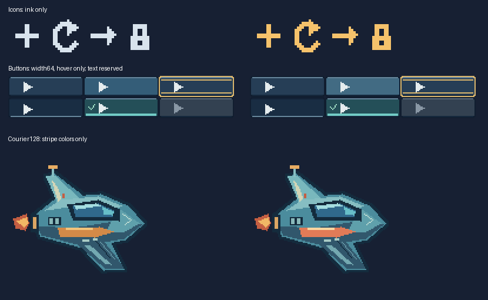

# Readable authoring recipes

2026-10-23 · **v1.2.0-rc.3 local candidate** · [Detailed Chinese report](recipe-workflows.zh-CN.md)

Four self-contained Python recipes now ship with the Skill: a named icon set, six-state buttons, a native 128px courier and a 256px component scene. Named parameters expose common edits while JSON v1 remains the exact exchange/rendering output. The repository example builder shares this geometry instead of maintaining a second copy. No new runtime dependency, input dialect or caching service is added.

```text
python <skill>/scripts/recipes/icons.py --out-dir icons --ink F5C26B
python <skill>/scripts/recipes/buttons.py --out-dir buttons --width 64 --content 28 4 30 10 --hover 426B83
python <skill>/scripts/recipes/courier128.py --out-dir courier --stripe E17B57 --stripe-light F9D5A0
python <skill>/scripts/recipes/scene256.py --out-dir scene --roof 684C6A --roof-light A07A89
```



Using only the ZIP in an unrelated Unicode/space directory with PYTHONPATH cleared, 17 scripted commands completed as expected, including one no-overwrite refusal. All four defaults exactly match frozen rc.2 RGBA at Pillow 12.3.0. Three edited specs independently rerender exactly. The courier stripe changes 328 pixels and zero outside its declared rectangle; the wide-button hover changes 832 pixels and zero outside its cell. Icon alpha/layout are unchanged. Scene components are rebuilt before assembly and exactly match the self-contained control.

The courier's 49-line/2,535-byte recipe provides an editable source for its 33,744-line/439,756-byte expanded JSON. A 2,613-byte shared helper and the normal runtime are also required. Output JSON stays unchanged in scale; this is source convenience, not measured model-token, timing or revision-count savings. Recipes remain examples rather than a prescribed visual style. Text rectangles are reserved; actual font/interaction acceptance is deferred to the consumer demonstration.

86 source tests, 43 stable-image regressions, 77 isolated ZIP cases and official Skill validation pass locally. 10 external final PNGs/layouts and 138 protected original/input hashes remain unchanged. The ZIP grows 9,222 bytes (4.3%) to 222,984 bytes/91 files. An author reviewed the before/after sheet, UI diagnostics and scene preview; this is not independent aesthetic evidence. [All eight CI jobs](https://github.com/Chenamel/deterministic-pixel-art/actions/runs/39919655914) pass on implementation commit `5f700d977a05e3e50dd1ae6de9fab7a7b0ee3917`, including Windows/Ubuntu and Pillow 10.4/11.3/12.1. Stable/local installation remains v1.1.1; the three external follow-ups keep the frozen rc.2 tool.

The local rc.3 Skill ZIP SHA-256 is `b680e73c966eb6557ed94bfc2e843dd4fca2c74c8aaf5f279caa2eeece6f308d`. It is sealed under `dist/v1.2.0-rc.3/` and has not been published or installed.

[Recipe reference](../skill/deterministic-pixel-art/references/recipes.md) · [Measurements](measurements/recipe-workflows.json) · [External assignments](focused-trials.zh-CN.md)
