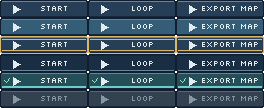

# rc.6：真实字体与状态文字闭环

2026-10-28，从 `e726942` 开始。根据rc.5外部使用反馈，新增一个可选辅助入口、修正错误提示和短说明。正式发布/本地安装仍为v1.1.1。

## 这次解决什么

`recipes/label_atlas.py` 读取PNG、内容绑定的布局、Context文字区域及调用者提供的字体，生成原尺寸/3倍消费端图和定位报告。明确选择单色或灰度字体覆盖；每个标签使用共享的单元局部原点，加上声明的状态偏移。在所有状态均满足预留区和边距后才输出，不自动缩字或裁字。源图集保持不含文字。

这替代本批两位UI模型重复编写的字体测量/合成辅助逻辑。是否降低外部模型的命令数或返工次数，仍由下一次真实任务验证。

`inspect --grid` 继续限制64×64/62色，错误现在包含已选尺寸、全图原点和可用操作。选择88×18单元后会建议改用全图坐标的局部 `--region` 或去掉 `--grid`，而不是只建议再次选择单元。矩形半开端点、短标签示例容量及Context/metadata的配合也已说明。

## 本地验证

| 检查 | 实际结果 |
|---|---|
| 源码 | 最终117项测试通过，警告按错误处理 |
| 独立ZIP | 中文/空格目录、清空PYTHONPATH后97项场景通过；官方Skill校验通过 |
| 兼容 | 43张稳定迁移产物不变；配方默认像素和现有公开接口继续通过 |
| 字体/状态 | Silkscreen8px、3标签×6状态，报告可重建18个实例；按下文字与图标同移1px |
| 失败识别 | 长标签放不下、偏移超出边距、缺失字体、过期布局、未知状态、缺失/重复文字区和覆盖均拒绝 |
| 新任务检查器 | 删除文字位移但同时重建匹配的图和报告，仅三个按下位移检查失败；旧LT02协议和冻结包不回写 |
| 保留 | 29个历史分发文件、44个已安装稳定Skill文件、8个用户提交文件均哈希不变 |

最初沿用的178文件清单含97个仓库生成Skill文件；这些属于本次授权重建范围。另行记录其中6个预期修改，新增1个辅助文件；其余81个不可变文件保持原样。没有将生成目录变更误报成安装变更。

[3倍图](ui-font-followup/consumer-3x.png)。作者代理已查看原尺寸和整数放大：标签完整、状态标记保留，按下图文位移一致。共享位置为满足现有10px高预留区、2px边距与1px位移求得；不等于所有字体的最佳视觉居中。

## 成本与范围

候选ZIP98文件、236,584字节，比封存rc.5增加5,023字节（2.169%）。只增加一个可选配方辅助，不扩展核心命令、JSON v1或运行依赖。辅助入口要求每格一个文字区域以及内容绑定布局；旧布局无摘要时，现有核心工具行为不变，该新辅助需要重新生成布局。

这是Windows/Python3.14.2/Pillow12.3.0下的本地工程验证和作者看图；外部UI复测、Linux实际平台和独立视觉复检尚待进行。本次不宣称普遍画质、token或跨模型排名收益。实现提交 `deb3ac5` 的8组Windows/Ubuntu及Pillow10.4、11.3、12.1、12.3 CI已全部成功，见 [CI记录](measurements/ui-font-followup-ci.json)。

## 下一步

先交付 `UI-followup.zip` 给WorkBuddy/DeepSeek的新会话；收到产物后，再整理仅含需求和图片的Gemini看图包，随后准备千问Linux任务。用户操作入口为 [test-handoff.zh-CN.md](test-handoff.zh-CN.md)。协调材料、历史结论和发布门槛不进入任务ZIP。

四主阶段P1/P2/P3/P4a完成，P4b原生512暂缓。目前处于候选使用体验修正及外部验收，不新增第五功能阶段，正式版门槛保持原定协议。

机器记录：[ui-font-followup.json](measurements/ui-font-followup.json)。原始日志保存在本地忽略的 `evaluation/ui-followup-20261028/`。
