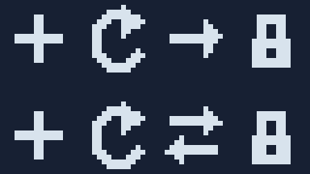

# AI 易用性、精确编辑与大尺寸工作流：本地候选版结果

后续状态：以下保留原本地候选验收快照。rc.2此后已[发布并通过8组CI](focused-trials-report.zh-CN.md)；[P2可读配方](recipe-workflows.zh-CN.md)为新的本地rc.3候选，原测量数字不改写。

日期：2026-10-23。版本：**v1.2.0-rc.2，本地候选版**。稳定版和本地已安装 Skill 仍为 v1.1.1。本轮没有公开发布、替换本地安装或修改原工具/模组资源。

## 实质改进

| 需求或已确认问题 | 实现与实际结果 |
|---|---|
| 浅色主背景上的剪影为空白 | 剪影按背景选择黑/白前景；深、浅、中灰及半透明回归通过，不修改源图 |
| 检查目标背景要自己写辅助脚本 | `render --preview-background` 可直接使用；审阅图提供各背景原尺寸及放大视图 |
| 相同内置背景声明也报重复 | 接受相同 `dark/light` 声明；改变内置颜色仍要求另用名称 |
| 云端挂载拒绝硬链接，无法正常输出 | 给出具体恢复提示；可显式 `--portable-output`，保持拒绝覆盖、并发预留和普通失败回滚 |
| PNG 导入后丢失图集名称和布局 | `import --metadata` 保留名称、顺序、位置、稀疏空位及全部解码 RGBA |
| 修改一格后难以证明其他区域没动 | `replace-cell` 更新一格；`verify` 按区域或空心蒙版检查原始 RGBA，包括全透明像素下的 RGB |
| 单元重心等信息不易找到 | `review.cell_summary` 展示已有 bbox、留白、占用率和像素质心，不伪造“视觉重量分数” |
| 大图组件/分块需要手算且易覆盖 | `assemble` 使用独立 PNG 清单，明确裁取、全局位置、copy/over、允许重叠与矩形覆盖要求，并输出接缝局部 |

旧 JSON v1、公共接口参数及绘制默认值保持兼容。新 atlas `assembly:"copy"`、`rows`、单元 `at` 和 `base` 均为可选扩展。旧 atlas 和 `blit` 默认 source-over 不变；新清单中的 copy/over 必须明确选择。

## 可编辑范例与视觉复检

- [命名单格编辑](../examples/workflows/atlas-editable.json)：transfer 改为双向箭头；改变 **66** 个像素，目标 `[32,0,16,16]` 之外 **0** 个 RGBA 变化。其余三个图标保持原样。
- [原生 128×128 非对称飞船](../examples/workflows/sprite-128.json)：使用原生坐标绘制，不是低分辨率 PNG 放大。查看了原尺寸、3 倍、深浅底、灰度及剪影；修正天线杆在背景上难见的问题。
- [256×256 场景组件](../examples/workflows/scene-components.json)：地形、磨坊、桥梁和装饰各有可编辑 JSON/PNG。修正箱子与树叶重叠，以及水轮离河道过远的问题。
- [四块拼合](../examples/workflows/scene-tiles.json)：四块 128×128 拼成 256×256，与[整图控制规格](../examples/workflows/scene-control.json)逐像素一致；矩形覆盖缺口 0，四条相邻边界、八个接缝局部均查看。

这是**作者代理自评，样本有限**。分块范例为完成整图后的裁切/重组控制，用于证明几何拼合准确；不证明多个 AI 独立绘制的块能自动保持构图、光照和轮廓连续。

## 检查结果

基准环境：Windows 11、Python 3.14.2、Pillow 12.3.0。

| 检查 | 本轮结果 |
|---|---|
| 源码测试（含警告视为错误的流水线运行） | **76/76** 通过 |
| v1.0.0 稳定迁移产物 | **43/43** 尺寸、RGBA 和图集布局保持兼容 |
| 历史夹具和冻结创作基线 | **86** 个夹具文件、**8** 项基线完整性通过 |
| 外部探索任务最终产物 | **10/10** PNG 与其规格精确复现，布局一致 |
| 原始工具/模组资源与外部输入保护 | **96 + 42 = 138** 文件哈希不变 |
| 独立中文空格目录中的 ZIP 命令测试 | **61/61** 通过；`PYTHONPATH/PYTHONHOME` 已清除 |
| 官方 skill-creator 校验器 | 通过；另一次全套 ZIP 执行同样 61 项通过 |
| 包资源与可复现性 | **85** 文件逐一校验；相同来源两次 ZIP 哈希一致 |

新增回归覆盖：空心蒙版内误改、隐藏 RGB、半透明、稀疏图集和顺序、旧 over 与显式 copy、过期布局拒绝、无覆盖写入、两个并发写入者只有一个成功、模拟写入失败清理、组件裁取/越界/缺口/重叠、源目录限制与输出别名保护。

本轮未实际运行新版 Ubuntu/Pillow 多版本 CI，也未回到原始 OSS/FUSE 挂载验证；原平台问题有日志支持，便携发布路径在受控模拟中通过。原有兼容矩阵保留，不能把旧版 CI 结果当成本次新版平台结果。

## 收益与成本分别记录

与 rc.1 使用同一解释器、Pillow 和输入进行本机 9 样本测量；完整命令交错顺序，去掉首轮热身。纯渲染/审阅使用 ship32，完整 render 包含 8 倍预览；完整 review 使用 courier128。

| 项目 | rc.1 → rc.2 | 解释 |
|---|---:|---|
| 纯 render 中位数 | 0.07576 → 0.07529 ms | 基本持平，不宣称提速 |
| 纯 review 中位数 | 6.8185 → 6.5223 ms | 小样本波动，不宣称提速 |
| 完整 render 命令中位数 | 175.37 → 197.07 ms | **增加 21.69 ms，约 12.4%** |
| 完整 review 命令中位数 | 235.02 → 258.78 ms | **增加 23.76 ms，约 10.1%** |
| 样例审阅 JSON | 7,505 → 8,966 字节 | 新卡片坐标和单元摘要带来额外文本 |
| 样例审阅拼板 | 816×932 → 816×1232 | 增加背景的原尺寸视图 |
| Skill ZIP | 113,055 → 213,762 字节 | **增加约 89%**，含原创大尺寸可编辑规格、PNG 和新工具 |

这不是模型效率实验。没有可靠的 token、模型耗时、修正轮次收益或通用审美提升结论。新增参考资料和大型规格按需读取，不需要每次全部载入。

## 已知限制与下一步

1. 几何覆盖包含透明像素；不自动推断前景、识别对象或判定审美。接缝颜色不同本身不是错误。
2. PNG 导入不能恢复原始图层或对象；copy 精确保留 RGBA，over 则有意合成。旧版本渲染器不会识别新可选字段。
3. 便携输出的新文件可能在写入中可见；普通失败尽力回滚，不承诺跨文件掉电事务。原子替换和便携新建的语义分开说明。
4. 跨 Pillow 的多边形填充可能不同。已在同一 Python 3.12 下确认 11.1/12.3 对一张飞船历史 v1 有 5 像素差异；固定 12.3.0 复现，不改变全局多边形算法。
5. 不把已有八项探索任务重新标为受控 A/B，也不凭本轮工程通过就提升稳定版本或替换本地安装。

接下来优先做三类短复测：WorkBuddy/DeepSeek 的单格与空心边框编辑；原千问挂载上的拒绝覆盖便携输出；Gemini 的命名 PNG 编辑和原生 128 图形检查。随后才做独立分块绘制试验：先冻结整体构图、调色板、光源、跨边界关键线和坐标，给每块上下文带；按 `crop` 规定最终像素归属，检查接缝并局部修正。先试 256×256，确认语义连续后再扩展 512×512。

本地恢复入口：仓库根目录 `WORK_STATE.md`；完整计划见 [roadmap-20261023.md](roadmap-20261023.md)。原始对话和证据留在 Git 忽略的本地 `evaluation/`，不进入 Skill 上下文。正式发布仍需相应平台检查与约定验收；当前交付可单独试用的候选包。
